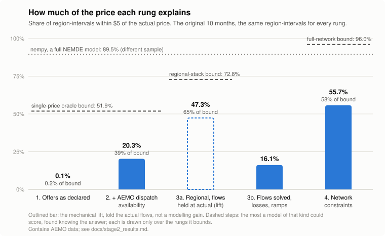
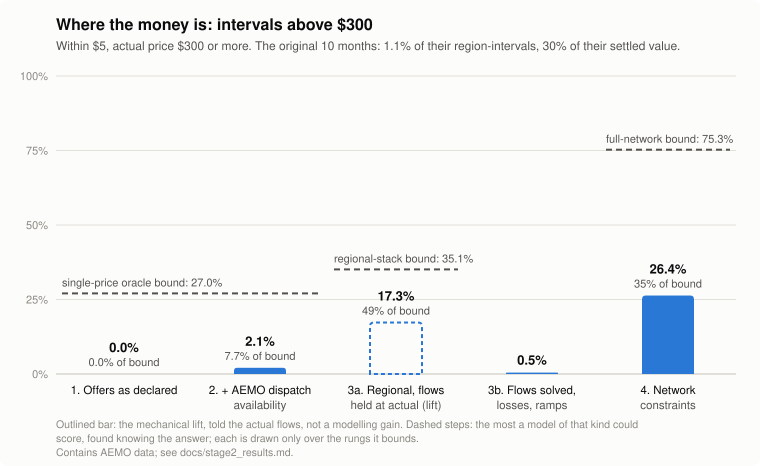

# NEM dispatch simulator

How much of the actual clearing price in Australia's National Electricity Market can a model explain, layer by layer, and how much of the *money* does each layer reach?

> Personal portfolio project. It describes past market outcomes. It is not energy market advice or financial advice.

## What is already known, and what this project adds

**This genre is not new, and this project builds on it.**

- **[nempy](https://github.com/UNSW-CEEM/nempy)** (UNSW CEEM, BSD-3-Clause) is an open model of the NEM dispatch procedure that reproduces AEMO's prices closely: 89.5% of region-intervals within $5 in N. Eschenbaum, *Shared Bidding Algorithms and Competition*, arXiv:2607.13002 v3, Appendix B, on a different sample from this one. It is the reference implementation, and this project does not compete with it.
- **N. Gorman, I. MacGill and A. Bruce, "Re-dispatch simplification analysis", *Applied Energy* 365 (2024)**, from the same group, asks almost this project's question, with a better method. Starting from a detailed NEM dispatch model, it removes one simplification at a time. It finds that neglecting FCAS and ramp rates has a relatively small effect, that simplifying bidding has a large one, and that **neglecting network and security constraints mainly affects peak prices.** It also names the trap in building a model up from a simple base, which is what this project does: a better fit may only mean errors now cancel. They call this confirmation holism. *I have read the abstract only; the paper is paywalled.*
- **[akxen/nemde](https://github.com/akxen/nemde)** rebuilds NEMDE from AEMO's per-interval casefiles, FCAS and fast start included, and backtests against NEMDE's own solution.

**What this project inherits:** the question, the answer that network constraints carry the price spikes, and the warning about building up from a simple base. Its ladder builds up from a merit order anyway, so read each rung's gain as a gain *from the rung below*, not as what that mechanism is worth on its own. Rung 3b below is a clean case of the trap.

**The cut I have not found reported:** accuracy **weighted by settled dollars and broken out by price band**, at 5-minute resolution against AEMO's prices, with every rung scored on the same region-intervals; **reachable bounds** saying how much of each band any model of a given kind could reach; and a **negative rung** with its mechanism measured. "Not found" rests on a handful of web searches and one central paper read only in abstract. If that paper reports a band or dollar-weighted decomposition, this part is a replication. [Section 9.3](docs/stage2_results.md#93-the-literature) has what was read and what was not.

## The finding, as it stands

**Network constraints are the only input-based layer that reaches the money, and even they leave most of it unreached:** rung 4 gets **26.4%** of spike region-intervals (above $300) within $5, against a reachable bound of **75.3%**.

| Actual price | Share of region-intervals | Share of settled value | Rung 2 | Rung 3a (mechanical lift) | Rung 3b | **Rung 4** |
|---|---:|---:|---:|---:|---:|---:|
| Negative | 18.6% | −2.4% | 37.6% | 64.8% | 41.3% | **77.6%** |
| $0–50 | 19.3% | 3.3% | 9.7% | 39.9% | 19.1% | **44.0%** |
| $50–300 | 61.0% | 68.8% | 18.6% | 44.9% | 7.8% | **53.2%** |
| **$300+** | **1.1%** | **30.3%** | **2.1%** | **17.3%** | **0.5%** | **26.4%** |
| All | 100% | 100% | 20.3% | 47.3% | 16.1% | **55.7%** |
| All, weighted by settled value | | | 12.8% | 30.1% | 3.9% | **44.3%** |

The cells are the share within $5 of the actual price, over ten months (433,900 region-intervals, the same for every rung). A $5 miss on a $40 price and on a $5,000 spike are not the same thing, so the table is split by actual price. The two share columns describe these ten months only. What the market looks like over a decade is in the next section, and it is the figure to quote.

### How much of the market's money is in spikes: ten years of the NEM

**Over ten financial years, region-intervals at $300 or more carried 23.4% of the NEM's settled value, on 2.1% of the time. That share swings from 5% to 42% from one year to the next.** That is a property of the market, measured on every 5-minute region-interval from July 2016 to June 2026 (5.3 million, $187.7 billion of settled value), not on the evaluation sample. Settled value is price × demand ÷ 12 per region-interval, the same definition the harness uses.

| Financial year | Settled value | Negative | $0–50 | $50–300 | **$300+** |
|---|---:|---:|---:|---:|---:|
| FY2017 | $17.2bn | −0.2% (1.1%) | 11.7% (33.4%) | 71.6% (64.7%) | **17.0%** (0.77%) |
| FY2018 | $16.6bn | −0.1% (0.3%) | 1.9% (5.6%) | 93.1% (93.7%) | **5.1%** (0.41%) |
| FY2019 | $18.8bn | −0.2% (1.0%) | 2.4% (10.2%) | 88.1% (88.2%) | **9.7%** (0.65%) |
| FY2020 | $13.5bn | −1.3% (2.5%) | 22.2% (46.5%) | 63.4% (50.5%) | **15.7%** (0.51%) |
| FY2021 | $11.7bn | −2.7% (4.8%) | 36.1% (67.4%) | 40.5% (27.3%) | **26.0%** (0.41%) |
| FY2022 | $26.0bn | −1.5% (10.2%) | 3.5% (23.7%) | 55.6% (58.5%) | **42.4%** (7.59%) |
| FY2023 | $26.7bn | −2.0% (11.2%) | 1.6% (15.2%) | 67.2% (66.2%) | **33.2%** (7.40%) |
| FY2024 | $18.3bn | −3.7% (14.1%) | 4.6% (22.5%) | 76.2% (61.9%) | **22.8%** (1.53%) |
| FY2025 | $24.4bn | −2.9% (17.0%) | 2.2% (15.5%) | 69.1% (66.1%) | **31.6%** (1.45%) |
| FY2026 | $14.5bn | −2.2% (17.9%) | 5.1% (20.2%) | 87.8% (61.3%) | **9.4%** (0.61%) |
| **Pooled, FY2017–FY2026** | **$187.7bn** | **−1.7%** (8.0%) | **7.2%** (26.0%) | **71.2%** (63.8%) | **23.4%** (2.13%) |

Each cell is the band's share of settled value, with its share of region-intervals in brackets. Bands use nominal dollars; the price cap rose from $14,000 to $17,500 over the decade.

- **About a quarter, not a third.** The ten-month sample's 30.3% was high because it contains June 2025. The median year is 19.9%, and without the 2022 energy crisis (FY2022 and FY2023) the pooled figure is 17.8%.
- **It has risen.** Since five-minute settlement began (October 2021) the pooled share is 30.5%; before it, 14%. Before October 2021 the market settled on 30-minute averages, which dilute a single 5-minute spike. Valued at what actually settled then, FY2017 to September 2021 gives 13.1% against 14% on 5-minute prices, so the measure does not drive the rise.
- **It is concentrated.** The ten biggest days of the decade hold 17.8% of all $300+ settled value: 12 June 2025 ($1.13bn), 5 August 2024 ($1.12bn), 26 June 2025 ($0.99bn), 31 January 2020 ($0.97bn) and 24 January 2019 ($0.93bn) lead.
- **The sample's figure was internally right.** On the same ten months the decade data gives 30.24%, matching the evaluation warehouse (`python -m nemsim.decade report`).

**So the dollar-weighting argument stands, at a smaller size:** a quarter of the decade's money sat in 2% of its region-intervals, and in some years two fifths. A model that misses the spikes misses that money however well it does on the rest.

**The $300+ row is mostly June 2025, and June 2025 was not a network event.** June supplies 45% of the region-intervals above $300 and 53% of that band's settled value. Two episodes, 11–13 June and 26–27 June, carry it. 12 June and 26 June alone hold 42% of the spike band's settled value across all ten months. The AER's report on the quarter's high prices attributes both to cold-weather demand, a calm wind and coal outages. It says network outages "did not contribute", and the mainland regions were price-aligned with interconnectors not limiting. Prices at the margin were set by a few hundred MW of rebids, batteries running out of charge, ramp limits and the energy–FCAS trade-off. [Section 9.2](docs/stage2_results.md#92-what-june-2025-was) has the detail and sources.

**Without June every directional conclusion holds, and most get stronger.** Rung 4 gets 30.3% within $5 on $300+ and 51.3% weighted by settled value, and the reachable bound is 85.3%. What did depend on June was a magnitude: in these ten months, spikes set 30% of settled value with June and 20% without it. That figure no longer stands for the market; the decade's 23.4%, above, replaces it.

| Rung | Includes, exactly | Within $5 | Reachable bound | Share of bound |
|---|---|---:|---:|---:|
| 1. Merit order, offers capped at declared availability | One NEM-wide stack of final energy offers, each capped at its own MAXAVAIL, and nothing else | 0.1% | 51.9% (single-price oracle) | 0.2% |
| 2. Merit order, offers capped at AEMO's dispatch availability | Rung 1, with wind and solar capped at AEMO's pre-dispatch forecast (UIGF), not realised output | 20.3% | 51.9% (single-price oracle) | 39% |
| 3a. Regional, flows held at actual | **The mechanical ceiling lift, not a modelling gain:** rung 2 as five regional stacks, each told its actual net interchange | 47.3% | 72.8% (regional stack) | 65% |
| 3b. Regional, flows solved | Rung 2 as a five-region LP: flows within standing ratings, AEMO's loss equation, ramp limits. **Worse than no network at all:** without the constraints that couple them, the links run past their real limits and parallel paths run against each other | 16.1% | | |
| 4. Network constraints | Rung 3b plus every invoked generic constraint it can represent (83% of them): their right-hand sides, set before dispatch, and their equations | 55.7% | 96.0% (full network) | 58% |

The ladder was renumbered on 2026-11-09. Losses, originally rung 4, now sit inside 3b, so constraints became rung 4 and there is no rung 5.





### Are spike prices in the bid stack?

Above $300, a region's price is often nowhere near any offer in that region. Offers alone could produce a price within $5 of the actual in only **35.1%** of spike region-intervals. A unit's offer also reaches its region's price through the shadow prices of the binding constraints it sits in; adding those raises the reachable share to **48.8%**. Adding the network carrying a neighbour's price across an interconnector raises it to **75.3%** (95% CI 68.3–84.3). So spike prices are mostly in the bids, reached through constraints and the network. The quarter left is in June 2025's scarcity and in Tasmania, where what sets the price (battery state of charge, rebidding, FCAS co-optimisation) is exactly what no rung here models. These bounds use actual outcomes, so they say what a model of each kind *could* reach, not what any model did.

## Why the numbers can be trusted, and where they cannot

**Each rung's inputs are checked to be set before dispatch, and the checks are tests or measurements, not assumptions.**

- **No outcome reaches a rung.** A rung declares its inputs; the harness never passes the actual price. A test asserts that rung 4 never sees `DISPATCHCONSTRAINT`'s marginal values, violation degrees or reported left-hand sides. Fields that are dispatch outcomes (cleared MW, the semi-dispatch cap flag, the calculated interconnector limits) are withheld. Where an outcome is used on purpose, the rung is labelled for it: 3a is told the flows, and the probe the calculated limits.
- **Conventions are measured, not assumed.** Several conventions were each settled on the data:
  - offer prices are divided by TLF × DLF: 71.5% exact against 0% for TLF alone, on marginal units;
  - interconnector losses take the sign of the flow;
  - load terms enter constraints with a positive sign;
  - **constraint shadow prices are subtracted:** on 7,662 marginal units inside a binding constraint, *band price ÷ (TLF × DLF) − Σ(marginal value × coefficient)* matches the regional price to the cent in 70% of cases, against under 1% with the other sign.
- **The constraint equations are AEMO's.** Rebuilt from actual dispatch, they match AEMO's reported left-hand side within 1 MW in **99.8%** of applied constraint-intervals when every term is included. On the binding energy-only constraints first checked, the match was 89%.
- **A price only explains another if it is itself explained.** In the reachable bound, a region's spike counts as reached through an interconnector only when the neighbour's own price is reachable from that neighbour's offers and shadow prices.
- **Only what is needed is downloaded.** The constraint equations in force go back to 2012. Only the 135 months whose versions are actually invoked were fetched: 667 requests at a 3-second gap, 101 MB. For 2012–2014 AEMO publishes each month only as one 1.9 GB zip, so HTTP range requests read each zip's directory and pulled out just the four small tables, avoiding about 25 GB of download.

**A stated bias.** Rung 4 drops constraint terms on units it has no variable for: loads held at actual, and non-scheduled units. That changes 27.7% of the constraint-intervals it applies. Measured against AEMO's reported values, the change leaves rung 4's constraints **tighter, not looser**, than the real ones. It concentrates in NSW and in negative and low-price intervals, where rung 4's prices also run high (+$8.6 mean error in the negative band). On binding constraints the mean effect is −0.1 MW, and on the $300+ band 94% of applied constraints match AEMO within 1 MW as rung 4 represents them. So it barely touches the 26.4%; the 55.7% has more exposure. The only pre-dispatch stand-in, `INITIALMW`, recovers almost none of it, so the terms stay dropped rather than being filled with actual MW ([section 9.1](docs/stage2_results.md#91-the-dropped-constraint-terms)). Battery charging is held at actual in every rung, and no rung models state of charge.

The harness also reproduces the stage 1 research's four simple-model figures to within about a point, including its 28%, which belongs to a model told the actual flows ([nemsim/reproduce.py](nemsim/reproduce.py)).

## Data

| Data | Source | Months |
|---|---|---|
| Final energy offers (`BIDPEROFFER_D`, `BIDDAYOFFER_D`) | AEMO monthly archive (MMSDM), downloaded here | 2024-10, 2024-11, 2025-06, 2025-08, 2025-09, 2025-11, 2025-12, 2026-01, 2026-02, 2026-05 |
| Unit dispatch solution (`DISPATCHLOAD`) | same | the same ten months |
| Constraint solutions (`DISPATCHCONSTRAINT`): invoked constraints and their right-hand sides | same | the same ten months |
| Interconnector ratings and loss model (`INTERCONNECTORCONSTRAINT`, `LOSSFACTORMODEL`) | same; standing tables with full version history | from the 2025-09 file |
| Constraint equations (`GENCONDATA`, `SPDCONNECTIONPOINTCONSTRAINT`, `SPDINTERCONNECTORCONSTRAINT`, `SPDREGIONCONSTRAINT`) | same; only the 135 months whose versions are invoked (`config/definition_months.txt`), 2012–2014 read by HTTP range requests from whole-month zips | 2012-07 to 2026-05 |
| Prices with ROP, regional demand, interconnector flows and limits, unit registration and loss factors, price cap and floor | read in place from [nem-market-explainer](https://github.com/abubakrdanish/nem-market-explainer)'s raw files | the months above, plus 2024-09 (the suspension case) |
| Regional prices and demand for the decade measurement (`DISPATCHPRICE`, `DISPATCHREGIONSUM`, `TRADINGPRICE`; four columns kept) | AEMO monthly archive for July 2016 to June 2021 (400 MB); the explainer's files from July 2021 | FY2017 to FY2026, in `warehouse/prices.duckdb` |

[docs/DATA.md](docs/DATA.md) lists what is on disk, what each part costs to rebuild, which parts are disposable, and where the resume state lives. The final-bid tables exist in the archive only up to February 2021 and from August 2024 onward, so this project works from August 2024 ([stage 1 research](docs/stage1_research.md), section 2). Only final bids are used. The full rebid history (about 12–18 GB compressed a month) is never downloaded.

### AEMO licence

AEMO gives general permission to use "AEMO Material for any purpose, but only with accurate and appropriate attribution". Its definition of AEMO Material names documents, reports and recordings, and it does not say whether market data files are covered. Like nem-market-explainer, this project treats the data as licensed for personal, non-commercial use with attribution, and redistributes none of it. Raw files, the DuckDB file and scored results are gitignored, and the test fixtures use made-up values. Offers carry participant names. Nothing in this repository is published per participant.

Contains data from the Australian Energy Market Operator (AEMO), nemweb.com.au. AEMO is the author of the data and has not reviewed or endorsed this project.

## Run it

Needs Python 3.11 or newer (3.12 tested), and a checkout of nem-market-explainer with its raw files downloaded, at the path in `config/settings.yml`. No accounts or API keys.

```
python -m venv .venv
source .venv/bin/activate
pip install -r requirements.lock
pip install -e . --no-deps

python -m nemsim.download --limit-mb 4700   # 4.6 GB (4,600 MB) from NEMWEB, about 17 minutes in all when last run; without the flag it refuses plans over 1,000 MB
python -m nemsim.ingest            # loads it and the explainer's files into warehouse/sim.duckdb, about 5 minutes; resumable
python -m nemsim.definitions       # the constraint equations rung 4 needs: 135 months, 667 requests, 101 MB, about 37 minutes; resumable
python -m nemsim.validate          # per month: files, interval coverage, and the 1 MW rebuild of every applied constraint's LHS
python -m nemsim.decade fetch      # ten years of regional prices and demand, 400 MB, about 14 minutes (then: load, report)
python -m nemsim.select_months     # rank the decade's months by settled value above $300
python -m nemsim.cases             # checks the research's test-case facts against the data
python -m nemsim.evaluate r1 --set stage1     # score rung 1 on the research day
python -m nemsim.evaluate r1 --set 2025-09    # or a whole month, about 12 s
python -m nemsim.reproduce         # re-run the research's four simple models through the harness
python -m nemsim.explain_r1 2025-09   # why rung 1 clears at negative prices: declared vs deliverable supply
python -m nemsim.evaluate r2 --set 2025-09    # rung 2; run it on each month before the diagnostics
python -m nemsim.diagnose_r2 ceiling        # also: held-off, ramp, leak, batteries, fcas, fcas-points
python -m nemsim.ceiling                   # every single-price rung against the oracle bound, by band and month
python -m nemsim.evaluate r3a --set 2025-09   # rung 3a, the mechanical lift (also r3b)
python -m nemsim.diagnose_r3 lossless       # also: noramps, calculated-limits (the ceiling probe)
python -m nemsim.evaluate r4 --set 2025-06   # rung 4; about 0.08 s per interval
python -m nemsim.audit_terms                # what rung 4's dropped constraint terms do, signed, against AEMO's reported LHS
python -m nemsim.curve                     # redraw docs/accuracy_curve.svg
python -m pytest                   # offline tests on synthetic fixtures
```

Loading peaks at about 8 GB of memory, while a month of `BIDPEROFFER_D` (3.4–4 GB uncompressed) is read and filtered to energy offers. The DuckDB file is 4.1 GB, and the raw zips 4.5 GB.

## How a rung is scored

A rung is a class with a list of the inputs it uses and a `solve` method that returns one price per region for one interval ([nemsim/rungs/base.py](nemsim/rungs/base.py)). The harness ([nemsim/harness.py](nemsim/harness.py)):

- loads only the inputs the rung declares, and never passes it the actual price;
- runs it on every interval in a named set ([nemsim/intervals.py](nemsim/intervals.py)): the research day, whole months, or the nine research test cases;
- excludes region-intervals with a reason instead of dropping them: `suspended` when suspension pricing replaced dispatch, `no_inputs` when, for example, no offers are loaded;
- reports the share within $1, $5, $10 and $20 and within 10%, the share within $5 weighted by settled value, the median and mean absolute error (also weighted by demand), and the mean signed error. It gives these overall and by actual price band (negative, $0–50, $50–300, $300+), by region, by whether an interconnector touching the region was at its limit, by whether a non-FCAS network constraint in the region was binding, and by whether the price was administered or an intervention run was present.

A new rung is one new module and one line in [nemsim/rungs/\_\_init\_\_.py](nemsim/rungs/__init__.py). The scoring does not change.

## Layout

```
config/       settings: download plan, paths, the explainer dependency
docs/         stage 1 research (the brief) and stage 2 results
nemsim/       download, load, inputs, harness, intervals and cases, rungs/
tests/        offline tests and a synthetic fixture warehouse
data/raw/     AEMO downloads (gitignored)
warehouse/    DuckDB file (gitignored)
results/      scored region-intervals and reports (gitignored)
```
