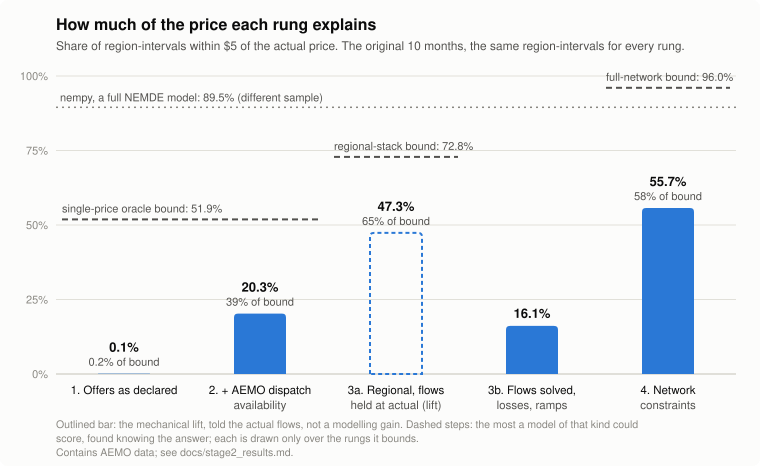
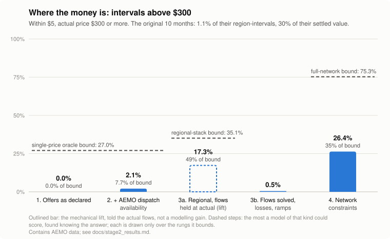

# The measurement harness and rungs 1 to 4

Built and run on 2026-11-08. Every figure here comes from the commands in the README, run against `warehouse/sim.duckdb`. Results files land in `results/` (gitignored).

**Which sample each figure is on.** The document grew as months were added, so samples differ by section, and each table or figure names its own:

- **Sections 4 and 5** open on the stage 1 research window (2025-09-01 04:05 to 2025-09-02 02:10, 1,330 region-intervals), then single months.
- **Section 6** is on the first eight months loaded.
- **Sections 7 to 10** are on the original ten months, unless a figure names a single month or day.
- **Section 13** compares the ten with the seven spike months and all seventeen.
- **Section 14** is single intervals and days.
- **Section 15** has every rung on all three samples, each on the region-intervals all five rungs scored. It is the place to compare rungs across samples.

The headline tables below are on the original ten months.

**The question this project ends on: are spike prices in the bid stack?** Mostly, yes. In stage 4, offers alone could reach only 35.1% of region-intervals above $300: in two thirds of spikes no offer in the region was near the price. Adding the actual shadow prices of binding constraints raises that reachable bound to 48.8%. Adding the network carrying a neighbour's price across a link raises it to **75.3%** (95% CI 68.3–84.3), and to 85.3% outside June 2025 ([section 8.1](#81-the-reachable-bound-on-the-300-band)). The quarter left is concentrated in the June 2025 scarcity and in Tasmania.

**The headline: accuracy by actual price band, ten months** (433,900 region-intervals, the same for every rung; settled value is price × demand × 5 minutes).

| Actual price | Share of region-intervals | Share of settled value | Rung 2 | Rung 3a (mechanical lift) | Rung 3b | **Rung 4** |
|---|---:|---:|---:|---:|---:|---:|
| Negative | 18.6% | −2.4% | 37.6% | 64.8% | 41.3% | **77.6%** |
| $0–50 | 19.3% | 3.3% | 9.7% | 39.9% | 19.1% | **44.0%** |
| $50–300 | 61.0% | 68.8% | 18.6% | 44.9% | 7.8% | **53.2%** |
| **$300+** | **1.1%** | **30.3%** | **2.1%** | **17.3%** | **0.5%** | **26.4%** |
| All | 100% | 100% | 20.3% | 47.3% | 16.1% | **55.7%** |
| All, weighted by settled value | | | 12.8% | 30.1% | 3.9% | **44.3%** |

The cells are the share within $5. **June 2025 supplies 45% of the $300+ region-intervals and more than half of that band's settled value**, so every $300+ figure here is substantially a claim about one winter scarcity episode. Without June, rung 4 is 30.3% within $5 on $300+.

**The accuracy curve, original ten months.** Within $5, against what each kind of model could reach (section 15 has the same on seventeen months):

| Rung | Includes, exactly | Within $5 | Reachable bound | Share of the bound | Within $5, $300+ |
|---|---|---:|---:|---:|---:|
| 1 | Final energy offers in one NEM-wide stack, each capped at its declared availability (MAXAVAIL) | 0.1% | 51.9% (single-price oracle) | 0.2% | 0.0% |
| 2 | Rung 1, with each unit capped at AEMO's dispatch availability: min(MAXAVAIL, UIGF forecast) for wind and solar | 20.3% | 51.9% (single-price oracle) | 39% | 2.1% |
| 3a | **Mechanical ceiling lift, not a modelling gain:** rung 2 as five regional stacks, each told its actual net interchange | 47.3% | 72.8% (regional stack) | 65% | 17.3% |
| 3b | Rung 2 as a five-region LP: flows solved within standing ratings, AEMO's loss equation, ramp limits | 16.1% | | | 0.5% |
| **4** | **Rung 3b plus every invoked generic constraint it can represent (83% of them), from inputs only** | **55.7%** | 96.0% (full network) | 58% | **26.4%** |
| Probe | 3b with the limits dispatch calculated (uses an outcome) | 52.8% | | | 24.5% |
| nempy, a full NEMDE model (different sample) | | 89.5% | | | |

The bounds are found knowing the answer, and each applies only to its own kind of model ([section 6.2](#62-the-single-price-oracle-bound-and-every-rung-against-what-it-could-reach), [section 7.2](#72-rung-3a-the-mechanical-ceiling-lift), [section 8.1](#81-the-reachable-bound-on-the-300-band)). **The ladder was renumbered on 2026-11-09.** The original plan had losses as rung 4 and network constraints as rung 5. Losses landed inside 3b in stage 4, so there is no separate loss rung, and the constraint rung is now **rung 4**: 1 merit order, 2 unit limits, 3a regional with flows at actual, 3b flows solved, 4 constraints. Earlier sections of this document use the new numbers.

**Short answer.** The harness reproduces the stage 1 research's four simple-model figures to within about one point.
- **Rung 1** explains essentially none of the price. Wind and solar declare far more availability than the weather supplies, so its stack always clears below zero ([section 4](#why-it-clears-at-about-60-to-100)).
- **Rung 2** caps them at AEMO's forecast for the interval (UIGF, made before dispatch) and reaches 20.3% within $5. It is accurate where money is not: 2.1% on the spike intervals that set 30% of settled value ([section 5](#5-rung-2-merit-order-each-offer-capped-at-aemos-dispatch-availability), [section 6](#6-fixing-the-measurement)).
- **Rung 3a**, told the actual flows, shows regional pricing can reach those intervals (17.3%).
- **Rung 3b** solves the flows from standing ratings and losses, and does worse than no network at all, because without the constraints that couple them the links run far past their real limits ([section 7](#7-rung-3-as-two-halves)).
- **Rung 4** adds the invoked constraint equations, from inputs only. It reaches **55.7%** within $5, **44.3%** weighted by settled value and **26.4%** on $300+, and beats the probe that used dispatch's own calculated limits. Its losses fall from 391 MW to 109 MW per interval against 97 MW actual, its overloaded link-intervals from 70% to 15%, and its parallel-path counter-flow by a third to two-fifths ([section 8](#8-rung-4-network-constraints)).

**Stage 6a** ([section 9](#9-auditing-the-baseline-naming-june-2025-and-the-literature)) audited rung 4's dropped constraint terms: they bias its constraints slightly *tighter*, mostly in NSW and low-price intervals, and barely touch the $300+ result. It found June 2025 to be two NEM-wide scarcity episodes that the AER says were not network-driven. And it found the central thesis already published: Gorman, MacGill and Bruce (2024) report that neglecting network constraints mainly affects peak prices. **So the claim holds for most of the money:** the expensive intervals belong to network constraints, and modelling those constraints from inputs is what reaches them. It stays open for the deepest scarcity spikes (June 2025, Tasmania), where FCAS co-optimisation is the one mechanism left to measure. FCAS explains little of rung 2's error and administered prices none ([section 6](#6-fixing-the-measurement)). **The research's 28%** belongs to a model that holds flows at actual and applies unit limits; through this harness it comes out at 27.2–28.6%. Four statements in the research turned out wrong or incomplete ([section 10](#11-what-the-research-got-wrong)), and they are corrected in place in [stage1_research.md](stage1_research.md).

---

## 1. Data ingested

### Downloaded from NEMWEB

Two downloads, 2,522 MB in all. The download command refuses a plan over 1,000 MB unless `--limit-mb` is raised. The second download went past that limit with agreement, for rung 2.

| Download | Files | MB | Time | Rate |
|---|---:|---:|---:|---:|
| Stage 2, rung 1 | 12 | 946.4 | 133 s | 7.1 MB/s |
| Rung 2 data (2026-11-08, approved past 1 GB) | 17 | 1,575.6 | 422 s | 3.7 MB/s |

The rate is with 3-second gaps between requests. The second download ran at about 2 MB/s for its first five files and about 10 MB/s after that, with no change on this side.

| Month | Tables | Why this month |
|---|---|---|
| 2025-09 | `BIDPEROFFER_D`, `BIDDAYOFFER_D`, `DISPATCHLOAD`, `DISPATCHCONSTRAINT`, `LOSSMODEL`, `LOSSFACTORMODEL`, `INTERCONNECTORCONSTRAINT` | The research day (test case 2); the loss model for later rungs |
| 2025-11 | `BIDPEROFFER_D`, `BIDDAYOFFER_D`, `DISPATCHCONSTRAINT`, `DISPATCHLOAD` | Test case 3, NSW1 at the cap with a binding constraint |
| 2026-05 | `BIDPEROFFER_D`, `BIDDAYOFFER_D`, `DISPATCHLOAD` | Test case 1, the ordinary control |
| 2025-08 | `BIDPEROFFER_D`, `BIDDAYOFFER_D`, `DISPATCHLOAD` | Test case 7, and the first 48 intervals of 2025-09 (trading day 31 August) |
| 2026-01 | same | Test case 4 |
| 2025-06 | same | Test case 5 |
| 2024-10 | same | Test case 6 |
| 2024-11 | same | Test case 9 |

`DISPATCHLOAD` for the three first-stage months was added in the second download, so rung 2 can be scored on every month that has offers.

### Read in place from nem-market-explainer

`DISPATCHPRICE`, `DISPATCHREGIONSUM` and `DISPATCHINTERCONNECTORRES` for those eight months and 2024-09, the month of the suspension case, which needs prices and flags only. `DUDETAILSUMMARY` and `MARKET_PRICE_THRESHOLDS` come from its newest standing file. These are reloaded from its raw zips rather than read from its warehouse, because its warehouse keeps only RRP and a few flags. ROP, `DISPATCHABLELOAD`, `MARGINALLOSS`, loss factors and the binding-constraint IDs are only in the raw files. Nothing in that repository is written.

### Load

Two runs, 245.5 s of loading in all. The first run (stage 2 files) took 92.8 s and peaked at 5.2 GB of memory. The second (the 17 new files) took 155.6 s and peaked at 7.9 GB. The DuckDB file is 1.84 GB, and the raw zips take 2.5 GB. Running again loads nothing.

| Table | Files | MB | Rows in files | Rows loaded | Seconds |
|---|---:|---:|---:|---:|---:|
| `BIDPEROFFER_D` | 8 | 1,247.1 | 137,612,724 | 35,645,208 | 156.0 |
| `DISPATCHLOAD` | 8 | 914.5 | 36,651,072 | 36,651,072 | 70.0 |
| `DISPATCHCONSTRAINT` | 2 | 344.5 | 20,403,676 | 20,403,676 | 13.5 |
| `DISPATCHREGIONSUM` | 9 | 55.3 | 394,620 | 394,620 | 2.4 |
| `DISPATCHPRICE` | 9 | 19.9 | 394,620 | 394,620 | 1.7 |
| `DISPATCHINTERCONNECTORRES` | 9 | 16.8 | 473,544 | 473,544 | 1.0 |
| `BIDDAYOFFER_D` | 8 | 15.7 | 478,070 | 123,823 | 1.0 |
| `DUDETAILSUMMARY`, `MARKET_PRICE_THRESHOLDS` | standing | 0.4 | 23,380 | 23,380 | 0.1 |
| `LOSSMODEL`, `LOSSFACTORMODEL`, `INTERCONNECTORCONSTRAINT` | 1 | 0.1 | 19,309 | 19,309 | 0.0 |

Every file's record count matches its closing `END OF REPORT` count, and every needed column is read by name. Two files are complete but cover less than their month; see [section 2](#2-facts-checked-before-anything-was-built-on-them).

### Deliberately left out

- **FCAS offers.** Ten of the eleven bid types, 74% of `BIDPEROFFER_D` rows, are filtered out while loading. No rung models FCAS yet. The zips are on disk if one does.
- **`REBIDEXPLANATION`.** Free text about named participants' behaviour, and no rung needs it.
- **FCAS enablement and trapezium columns in `DISPATCHLOAD`**, and FCAS prices in `DISPATCHPRICE`.
- **The full rebid history** (`BIDOFFERPERIOD`, `BIDDAYOFFER`): 12–18 GB compressed a month.
- **Constraint definitions** (`GENCONDATA`, `SPD*CONSTRAINT`) were left out until stage 5, then fetched only for the 135 months whose versions are invoked ([section 8.2](#82-the-data)).
- **`DISPATCHCONSTRAINT` outside 2025-09 and 2025-11** was left out until stage 5, then added for all ten months (1,407 MB; [section 8.2](#82-the-data)).
- **Bids for 2025-10 and 2026-04.** Without them the first 48 intervals of 2025-11 and 2026-05 (00:05 to 04:00 on the 1st, the previous trading day) have no offers and show as `no_inputs`.

---

## 2. Facts checked before anything was built on them

| Question | Answer | Evidence |
|---|---|---|
| What demand does NEMDE balance? (research: open, "first thing to check") | `TOTALDEMAND = DISPATCHABLEGENERATION − DISPATCHABLELOAD − NETINTERCHANGE` | Holds to 0.01 MW in all 43,200 September 2025 region-intervals except six consecutive NSW1 intervals (17:10–17:35 on 2025-09-01), which are off by up to 50 MW. `DISPATCHABLEGENERATION` and `DISPATCHABLELOAD` equal the sums of `DISPATCHLOAD.TOTALCLEARED` by region, apart from gaps of up to 50 MW in a few QLD1 and NSW1 intervals. `CLEAREDSUPPLY` is something else, up to 2,311 MW away |
| How are band prices referred to the regional node? | Divide by TLF × DLF, not TLF alone | Of the 136 units with DLF ≠ 1, 134 have a `MINIMUM_ENERGY_PRICE` of −1,000 × TLF × DLF, and none has −1,000 × TLF. On 2025-09-01, 68 of the 77 such generators had a top band exactly at 20,300 × TLF × DLF, and none at 20,300 × TLF. Example: WSTWYSF1 bids −859.31 = −1,000 × 0.922 × 0.932 |
| Is wind and solar availability capped at UIGF in `DISPATCHLOAD`? | Yes, already | `AVAILABILITY` is never above `UIGF` for semi-scheduled units |
| Do offered band MW respect MAXAVAIL? | No | On 2025-09-01, generators' bands summed to about 95 GW against about 52 GW of MAXAVAIL |
| Energy offer directions | `GEN` and `LOAD` only | `BIDIRECTIONAL` appears only on FCAS bid types. Batteries offer energy as separate `GEN` and `LOAD` rows |
| Do the monthly files cover their months? | All but two | `DISPATCHLOAD` for 2025-09 stops at 04:00 on 30 September: 8,400 of 8,640 intervals. The file is complete by its own record count, so the archive file itself is short; the last 20 hours are missing. `BIDPEROFFER_D` for 2024-11 has no rows for 13:30–13:45 on 19 November 2024 (4 intervals). Rung 1 is unaffected by the first. Rung 2 will show those 240 intervals as `no_inputs`; the research day is not among them |
| Bid grain | One row per trading day, unit and direction in `BIDDAYOFFER_D`; per interval in `BIDPEROFFER_D` | No duplicate keys in all eight months (123,823 and 35,645,208 rows), and every per-interval offer has its day offer. `DISPATCHLOAD` has no duplicate (interval, unit, run) keys either. A trading day runs 04:05 to 04:00, so a month's file starts at 04:05 on the 1st. The 48 intervals from 00:05 to 04:00 on the 1st are in the previous month's file, and show as `no_inputs` when that month is not loaded |

---

## 3. The harness

**The contract.** A rung is a subclass of `Rung` ([nemsim/rungs/base.py](../nemsim/rungs/base.py)) with a `key`, a `name`, a one-line `summary`, a set of declared `uses`, and `solve(inputs) → one row per region with a price`. That is the whole interface. A rung may also return `marginal_duid`, `bracket_lo` and `bracket_hi`, and the harness scores the bracket when they are there.

**Inputs** ([nemsim/inputs.py](../nemsim/inputs.py)) are named, and every name says whether it is a genuine input or an AEMO outcome held at its actual value:

| Input | What | Kind |
|---|---|---|
| `offers` | Band MW, band price ÷ (TLF × DLF), MAXAVAIL, region | input |
| `demand` | Regional `TOTALDEMAND` | input |
| `scheduled_load` | Cleared scheduled load per region | outcome |
| `regional_dispatch` | Cleared generation and net interchange per region | outcome |
| `units` | Availability, initial MW, ramp rates (`TOTALCLEARED` withheld) | input to dispatch |
| `interconnectors` | Limits and marginal loss factors (flows withheld) | input to dispatch |

The harness loads only what a rung declares. The actual price is never an input, and a test asserts both.

**Scoring** ([nemsim/harness.py](../nemsim/harness.py)). One row per region-interval: model price, RRP, ROP, error and classes. The default target is RRP from the pricing run (`INTERVENTION = 0`), and `--target rop` scores against the price before overrides. In the loaded months, ROP differs from RRP in 103 region-intervals: 81 in 2024-09, the suspension month, and 22 across the eight months with offers. Statistics: share within $1, $5, $10 and $20, median and mean absolute error, mean signed error, and bracket containment when a rung provides it. They are given overall and by:

- **region**;
- **interconnector at a limit**: any link touching the region has its flow within 0.1 MW of a limit, or crossed limits. This is the rule nem-market-explainer's mart uses;
- **non-FCAS network constraint binding in the region**: a constraint with non-zero marginal value, assigned to a region by AEMO's naming convention. Unit constraints (`#UNIT…`, `$UNIT`) take the unit's region; `C_X_`, `NC_X_` and `NSA_X_` the letter after the prefix; otherwise the first letter. This covers 96.9% of binding non-FCAS constraint-intervals. The rest, mainly `I_6F_SN_150` and `I_6F_NS_150`, are inter-regional or do not fit the convention. **It is a heuristic.** Rung 4's coefficient data would replace it. The class is blank, not false, in months without `DISPATCHCONSTRAINT`. A region-level split is the only useful one, because at interval level some non-FCAS constraint binds 98.7–99.8% of the time;
- **actual price band**: negative, $0–50, $50–300, $300+ (the headline since [section 6](#6-fixing-the-measurement); earlier sections cut at $0, $300 and $5,000);
- **administered price or intervention run**, flagged but scored ([section 6.4](#64-intervention-and-administered-pricing)).

Besides the shares within $1, $5, $10 and $20, the harness reports the share **within 10%** of the actual price, the share within $5 **weighted by settled value** (|price| × demand × 5 minutes), and mean absolute error **weighted by demand**.

**Exclusions** are kept with a reason, never dropped. `suspended` applies per region-interval and outranks the others. `no_inputs` means the interval lacks something the rung declared, usually offers.

**Interval sets** ([nemsim/intervals.py](../nemsim/intervals.py)): `stage1` (the research window, 2025-09-01 04:05 to 2025-09-02 02:10, 266 intervals), whole months, each of the nine research test cases, and `cases` (all nine together).

**Adding a rung** is a new module under `nemsim/rungs/` and one line in `LADDER`. Rung 2 was added exactly that way, with no change to the scoring. The one change outside it was withholding `SEMIDISPATCHCAP`, a dispatch outcome, from the `units` input. A test (`test_a_new_rung_plugs_in_unchanged`) adds a rung the same way.

---

## 4. Rung 1: merit order, each offer capped at its declared availability

**What it includes, exactly.** Final energy offers, each capped at its own declared availability (MAXAVAIL), in one stack for the whole NEM, and nothing else. Every generation offer goes in with its band MW filled in band order up to the offer's MAXAVAIL, at band price ÷ (TLF × DLF). Cheapest first until demand is met; the band that meets it sets the price for every region. Demand is Σ `TOTALDEMAND` + Σ cleared scheduled load. A supply-only stack cannot clear pumping and battery charging, so scheduled load is the one input held at its actual outcome.

**What it leaves out.** AEMO's unit limits (availability capped at AEMO's forecast for wind and solar, ramp rates from initial MW), interconnectors, losses, network constraints, FCAS, and fast-start profiles.

**This is the "bare" rung, but not "no limits at all".** MAXAVAIL is applied because it is part of the bid: the participant's own statement of how much it offers, which NEMDE always honours. It is not a limit AEMO imposes. Without it the stack holds 95 GW against 52 GW declared, and the rung means nothing: a median error of $1,146 on the research day, where the research reports $622 for its "no-bounds" row. With it, $626.

**Why NEM-wide, not regional.** "No interconnectors" leaves two readings. One is a single copper-plate stack. The other is five regional stacks with flows fixed at actual, which is what the research did. The second already knows how much power crossed every link, so it leaks the answer the interconnector rung is meant to work out. Rung 3 would then replace a perfect oracle with a model and could score *worse*. The regional fixed-flow model is kept only as a reproduction check ([section 5](#10-reproducing-the-research)), labelled as such, and is not a rung.

### Results

Research window (`stage1`, 1,330 region-intervals, all scored):

| | Within $1 | Within $5 | Within $10 | Within $20 | Median abs error | Mean error |
|---|---:|---:|---:|---:|---:|---:|
| Rung 1 | 0.0% | 0.0% | 0.0% | 0.0% | $626 | −$707 |
| Research, "one NEM stack, no unit bounds" | 0% | 0% | — | 0% | $622 | — |

Eight months (349,900 region-intervals scored; 1,460 `no_inputs`: the first 48 intervals of months whose previous month is not loaded, and the 4 missing intervals of 2024-11):

| | Region-intervals | Within $1 | Within $5 | Within $10 | Within $20 | Median abs error | Mean error |
|---|---:|---:|---:|---:|---:|---:|---:|
| All | 349,900 | 0.0% | 0.1% | 0.2% | 0.7% | $161 | −$250 |
| 2024-10 | 44,400 | 0.0% | 0.2% | 0.5% | 2.2% | $147 | −$219 |
| 2024-11 | 43,180 | 0.1% | 0.1% | 0.3% | 0.6% | $200 | −$364 |
| 2025-06 | 42,960 | 0.0% | 0.1% | 0.1% | 0.3% | $184 | −$317 |
| 2025-08 | 44,400 | 0.0% | 0.0% | 0.1% | 0.4% | $174 | −$231 |
| 2025-09 | 43,200 | 0.0% | 0.2% | 0.3% | 1.1% | $125 | −$184 |
| 2025-11 | 42,960 | 0.0% | 0.2% | 0.4% | 1.1% | $138 | −$194 |
| 2026-01 | 44,400 | 0.0% | 0.0% | 0.1% | 0.3% | $152 | −$291 |
| 2026-05 | 44,400 | 0.0% | 0.0% | 0.0% | 0.0% | $162 | −$207 |

By region, link state, constraint state and price class (eight months; price classes at the cut points used then, re-cut in [section 6](#6-fixing-the-measurement)):

| Class | Region-intervals | Within $5 | Within $20 | Median abs error | Mean error |
|---|---:|---:|---:|---:|---:|
| NSW1 | 69,980 | 0.0% | 0.4% | $165 | −$273 |
| QLD1 | 69,980 | 0.0% | 0.8% | $161 | −$248 |
| SA1 | 69,980 | 0.3% | 1.4% | $153 | −$249 |
| TAS1 | 69,980 | 0.0% | 0.1% | $171 | −$249 |
| VIC1 | 69,980 | 0.2% | 0.9% | $147 | −$233 |
| A link touching the region at a limit | 196,956 | 0.2% | 1.3% | $146 | −$257 |
| No link at a limit | 152,944 | 0.0% | 0.0% | $172 | −$243 |
| Non-FCAS constraint binding in region (2025-09, 2025-11) | 56,260 | 0.2% | 1.4% | $116 | −$182 |
| None binding (2025-09, 2025-11) | 29,900 | 0.1% | 0.5% | $152 | −$201 |
| Constraint state unknown (other six months) | 263,740 | 0.1% | 0.6% | $169 | −$271 |
| Actual price negative | 64,301 | 0.6% | 4.0% | $63 | −$198 |
| $0–300 | 281,025 | 0.0% | 0.0% | $170 | −$231 |
| $300–5,000 | 4,039 | 0.0% | 0.0% | $510 | −$838 |
| $5,000 and above | 535 | 0.0% | 0.0% | $10,807 | −$12,439 |

Test cases (all nine now have data):

| Case | Region-intervals scored | Within $5 | Median abs error | Mean error |
|---|---:|---:|---:|---:|
| 1. Ordinary control | 10 | 0% | $219 | −$215 |
| 2. 2025-09-01, the research day (calendar day) | 1,440 | 0% | $402 | −$656 |
| 3. NSW1 at the cap | 20 | 0% | $259 | −$4,292 |
| 4. SA1 at the cap | 25 | 0% | $159 | −$4,205 |
| 5. Winter scarcity | 815 | 0% | $999 | −$2,687 |
| 6. Deep negative SA1 | 240 | 0% | $118 | −$45 |
| 7. SA1 FCAS stress | 1,440 | 0% | $156 | −$158 |
| 8. Suspension | 0 (80 of 80 excluded as `suspended`) | | | |
| 9. Intervention (pricing run scored) | 60 | 0% | $1,000 | −$1,050 |

### What it shows

- **Rung 1 prices too low in effect every interval.** The mean error is within a dollar of minus the mean absolute error. Half of its prices fall between −$100 and −$60 (the median is −$66). The price-setter is a wind farm in 57% of intervals and a solar farm in 34%; STOCKYD1, RYEPARK1, BRYB1WF1 and MUSSELR1 are the most frequent. Why is explained [below](#why-it-clears-at-about-60-to-100).
- **It is "best" where prices are negative, and only because it is always low.** The breakdowns that seem to favour link-limited and constraint-bound intervals are the same effect. Those intervals are more often negative in the actual data, so a model stuck below zero lands closer. Case 6, deep negative SA1, has its smallest mean error (−$45) for the same reason.
- **The research day was unusually bad for this model.** On the 2025-09-01 trading day the stack priced at the floor in 40% of intervals, which it does on only one other September day (28 September). Its daily median error was $402, against $70–$180 on a typical day. The median of $626 over the window is unstable too. The errors fall into two groups, floor-priced (about $1,100) and −$65-priced (a few hundred). Dropping the last 26 intervals of the window moves the median to $1,020.
- **It fails every test case**, including case 1, the ordinary control the research said must not fail. The suspension case is refused in full, as it must be.

### Why it clears at about −$60 to −$100

Rung 1 stacks what participants say they could generate, and for wind and solar that is far more than the weather allows. A wind or solar farm's MAXAVAIL is its own declaration. Over the eight months, wind farms declared 11.6 GW on average while the wind could supply 4.1 GW, and solar farms declared 9.6 GW against 2.5 GW. Solar farms kept declaring 8.2–10.8 GW through the night, in every month, when they could deliver nothing. In the real market this costs a farm nothing. NEMDE caps every wind and solar unit at AEMO's own forecast of its output (UIGF), so a farm can leave its declaration near nameplate and let the forecast do the limiting; that reading of participants' motives is an inference, and the data shows only the gap. Rung 1 has no forecast. Its stack holds 32.4 GW priced below $0 against 21.2 GW of demand, so demand is met inside the negative part of the stack in **every interval of every month**. 14.3 GW of that sub-zero supply does not physically exist: 7.3 GW of wind and 7.0 GW of solar. Wind and solar put most of their volume either at the floor or in bands between about −$100 and −$40 (4.7 GW on average), and that is where demand lands. That is why the price-setter is a renewable farm in nine intervals out of ten. (Why farms put bands there is not verified here. They plausibly reflect what a farm earns per MWh outside the spot price, from certificates and contracts, so it will pay up to that much to keep generating.) The rest of rung 1's errors follow from the same blind spot. It dispatches 3.9 GW of solar on average when 2.0 GW actually ran, and 6.0 GW of wind against 3.7 GW. That phantom output displaces 3.1 GW of coal and three-fifths of the hydro that actually ran. The stack seldom reaches the positive-priced bands of thermal plant, hydro and storage, which set most real prices. The real market is not cheaper than the offers suggest; the offers overstate what is there.

The strongest evidence is what happens when the same offers are capped at what AEMO let each unit deliver (its `DISPATCHLOAD` availability), with nothing else changed:

| Month | Demand, MW | Declared below $0, MW | Deliverable below $0, MW | Intervals where declared below-$0 supply covers demand | … where deliverable below-$0 supply covers demand | Region-intervals with a negative actual price |
|---|---:|---:|---:|---:|---:|---:|
| 2024-10 | 18,622 | 28,433 | 16,456 | 100% | 30.9% | 27.1% |
| 2024-11 | 20,061 | 29,563 | 16,842 | 100% | 18.8% | 17.4% |
| 2025-06 | 24,284 | 34,197 | 19,075 | 100% | 3.2% | 6.6% |
| 2025-08 | 22,840 | 33,920 | 18,870 | 100% | 16.3% | 14.2% |
| 2025-09 | 20,063 | 32,218 | 18,149 | 100% | 31.9% | 27.7% |
| 2025-11 | 20,110 | 32,421 | 18,553 | 100% | 36.8% | 30.9% |
| 2026-01 | 21,717 | 33,909 | 19,606 | 100% | 29.0% | 16.2% |
| 2026-05 | 21,992 | 34,508 | 17,508 | 100% | 7.1% | 7.0% |
| All | 21,215 | 32,400 | 18,131 | 100% | 21.7% | 18.3% |

With declared availability the stack has to clear below zero every time. With deliverable availability it does so in a share of intervals that tracks, month by month, how often the real price went negative: 3% against 7% in June 2025, 37% against 31% in November 2025. January 2026 is the one wide gap, 29% against 16%, and later rungs should explain it. Interconnector limits and constraints stop cheap supply reaching demand, and battery charging lifts the price. This one correction does not make the rung accurate. The comparison is only of whether supply below zero is enough to meet demand. But it moves the stack from a regime it can never leave to the right one.

This is what the later rungs are for. Rung 2 replaces declared availability with what AEMO lets each unit deliver: the forecast for wind and solar, and ramp rates from initial MW for thermal plant. That removes the phantom supply. The research's one-stack model with those limits already moves from 0% to 9% within $5 on the research day. Rungs 3 and 4 then deal with real supply in the wrong place: cheap power stranded behind interconnector limits, lost between regions, or held off by network constraints.

`python -m nemsim.explain_r1 <month>` prints these figures, by fuel and by hour, for any month with offers and `DISPATCHLOAD` loaded. Fuel types come from nem-market-explainer's `GENUNITS`, read-only. Dispatch per fuel counts every band priced below rung 1's price, so it slightly understates the marginal band. Interval counts are those with both offers and `DISPATCHLOAD`, which excludes the last 20 hours of September 2025.

**Verdict.** Rung 1 adds nothing over a constant, and that is the finding: the offers on their own do not explain the price, because for wind and solar they describe capacity rather than supply. Everything the research's 28% explains comes from the unit limits and the fixed flows.

---

## 5. Rung 2: merit order, each offer capped at AEMO's dispatch availability

**What it includes, exactly.** Rung 1, plus one change. Each unit's bands are filled up to min(MAXAVAIL, `DISPATCHLOAD.AVAILABILITY`) instead of MAXAVAIL alone. Nothing else changes: still one NEM-wide stack, no ramp rates, no interconnectors, no losses, no constraints, no FCAS, and scheduled load held at actual.

**What that change touches.** Only wind and solar. In September 2025, `AVAILABILITY` equals MAXAVAIL in 100% of 1.48 million scheduled-generator unit-intervals and 367,000 battery unit-intervals. It equals min(MAXAVAIL, UIGF) in 100% of 1.6 million wind and solar (semi-scheduled) unit-intervals. For every other unit, rung 1 already used what dispatch uses. Every generation offer in the eight months has a `DISPATCHLOAD` row, so no unit's limit is guessed.

### Which availability, and why it is an input

**The field: `DISPATCHLOAD.AVAILABILITY`**, from the pricing run (`INTERVENTION = 0`). For wind and solar it is min(MAXAVAIL, UIGF). UIGF is AEMO's forecast of what the unit could produce by the end of the interval if dispatch did not limit it. NEMDE receives it before the dispatch run, as one of the run's inputs; that sequence is AEMO's documented process, not something this project re-checked.

**Why it counts as an input, not an outcome.** Dispatch reads it; it does not produce it. The data agrees. For wind and solar units that dispatch did not cap, UIGF misses the unit's actual output at the end of the interval by 2.31 MW on average, and is within 0.5 MW only 56% of the time (September 2025, 1.59 million unit-intervals). A value that already knew the outcome would match it. UIGF is a short-range forecast built on current output, so it is barely better than assuming output stays where it is (2.41 MW). But it is a forecast.

**The alternatives, and why each was rejected:**

| Alternative | What it is | Why not |
|---|---|---|
| Realised output at the end of the interval | SCADA labelled with the next interval, which equals that interval's `INITIALMW` | An outcome. It already contains the curtailment NEMDE chose. In September 2025 wind and solar produced 6.19 GW on average against a forecast of 7.56 GW, and dispatch capped a unit in 19.7% of unit-intervals. That 1.37 GW gap comes from negative prices and network limits, which are rungs 3–5's job |
| `TOTALCLEARED` | The dispatch target | It is the answer itself. Summed across all wind and solar it equals realised output to within 0.1 MW, though a single unit's target and output differ by about 2.3 MW on average |
| `INITIALMW` | Output measured at the start of the interval | Measured before dispatch, and kept in the `units` input for ramp limits. As an availability cap for wind and solar it would carry the previous interval's curtailment into this one, so it would leak the previous answer |

`TOTALCLEARED` and `SEMIDISPATCHCAP`, the flag saying whether dispatch capped a unit, are both withheld from every rung, and a test checks it.

**What the leak would have done, measured.** `python -m nemsim.diagnose_r2 leak` runs rung 2 once with wind and solar capped at realised output, on the same 348,700 region-intervals:

| | Within $1 | Within $5 | Within $20 | Median abs error | Mean error |
|---|---:|---:|---:|---:|---:|
| Rung 2 (dispatch availability) | 6.9% | 19.7% | 49.6% | $20.2 | −$25.3 |
| Leak: realised output | 6.3% | 16.6% | 46.9% | $21.8 | −$14.9 |

The leak does what was expected to the bias: it removes about 40% of it, because it hands the rung the curtailment for free. But it makes the rung *less* accurate, by 3.1 points within $5. In a merit order the price-setter is, by definition, only partly dispatched. A farm capped at what it actually produced has no headroom left, so it can never set the price. Under rung 2, wind and solar set the price in 21.8% of intervals; under the leak, in 4.1%. In the real market, curtailed renewables are often exactly the units setting low prices. So the leak would have made rung 2 look better on bias and worse on accuracy. Either way the rung would be measuring something it was told rather than something it modelled.

**A side finding for nem-market-explainer.** `DISPATCH_UNIT_SCADA` labelled with an interval equals that interval's `INITIALMW` exactly (mean difference 0.00 MW over 1.6 million rows). So SCADA is the reading at the *start* of the interval. The explainer's documentation describes it as output "at the end of each interval". Nothing in that repository was changed.

### Results

Research window (`stage1`, 1,330 region-intervals):

| | Within $1 | Within $5 | Within $10 | Within $20 | Median abs error | Mean error |
|---|---:|---:|---:|---:|---:|---:|
| Rung 1 | 0.0% | 0.0% | 0.0% | 0.0% | $626 | −$707 |
| **Rung 2** | **6.2%** | **12.3%** | **18.9%** | **37.9%** | **$30.5** | **−$35** |
| Research, one NEM stack with availability *and* ramp limits | — | 9.1% | — | 29.1% | $36.87 | — |

Eight months (348,700 region-intervals scored; 2,660 `no_inputs`: rung 1's 1,460, plus the 1,200 region-intervals of September 2025 that AEMO's `DISPATCHLOAD` file is missing):

| | Within $1 | Within $5 | Within $10 | Within $20 | Median abs error | Mean error |
|---|---:|---:|---:|---:|---:|---:|
| **All** | **6.9%** | **19.7%** | **32.2%** | **49.6%** | **$20.2** | **−$25.3** |
| 2024-10 | 6.7% | 17.7% | 29.1% | 44.1% | $25.2 | −$10.2 |
| 2024-11 | 6.3% | 17.1% | 28.8% | 45.6% | $23.4 | −$48.5 |
| 2025-06 | 5.6% | 14.5% | 24.5% | 40.9% | $27.0 | −$61.1 |
| 2025-08 | 6.0% | 17.6% | 28.8% | 45.9% | $22.4 | −$15.1 |
| 2025-09 | 7.8% | 22.3% | 34.3% | 52.7% | $18.4 | −$5.7 |
| 2025-11 | 8.7% | 25.4% | 38.6% | 56.6% | $15.5 | −$9.7 |
| 2026-01 | 7.1% | 19.4% | 34.7% | 51.1% | $19.1 | −$45.1 |
| 2026-05 | 7.4% | 24.0% | 38.8% | 60.0% | $14.6 | −$7.4 |

By class (eight months; price classes at the cut points used then, re-cut in [section 6](#6-fixing-the-measurement)):

| Class | Region-intervals | Within $5 | Within $20 | Median abs error | Mean error |
|---|---:|---:|---:|---:|---:|
| NSW1 | 69,740 | 24.6% | 56.1% | $16.2 | −$47.9 |
| QLD1 | 69,740 | 22.8% | 53.9% | $17.7 | −$23.2 |
| SA1 | 69,740 | 19.2% | 50.2% | $19.9 | −$23.5 |
| TAS1 | 69,740 | 9.5% | 31.5% | $35.8 | −$24.0 |
| VIC1 | 69,740 | 22.7% | 56.4% | $15.9 | −$8.0 |
| A link touching the region at a limit | 196,222 | 20.7% | 47.2% | $21.9 | −$26.3 |
| No link at a limit | 152,478 | 18.5% | 52.6% | $18.4 | −$24.1 |
| Non-FCAS constraint binding in region (2025-09, 2025-11) | 55,698 | 28.0% | 58.8% | $14.1 | −$6.2 |
| None binding (2025-09, 2025-11) | 29,262 | 15.9% | 46.8% | $21.5 | −$10.7 |
| Actual price negative | 63,955 | 37.2% | 66.0% | $9.3 | **+$18.8** |
| $0–300 | 280,171 | 16.1% | 46.5% | $22.1 | −$15.8 |
| $300–5,000 | 4,039 | 2.4% | 8.0% | $196 | −$293 |
| $5,000 and above | 535 | 0.6% | 1.3% | $8,036 | −$8,248 |

Test cases:

| Case | Scored | Within $5 | Median abs error | Mean error |
|---|---:|---:|---:|---:|
| 1. Ordinary control | 10 | 0% | $10 | +$2 |
| 2. The research day (calendar day) | 1,440 | 14.9% | $29 | −$33 |
| 3. NSW1 at the cap | 20 | 20.0% | $58 | −$4,105 |
| 4. SA1 at the cap | 25 | 12.0% | $35 | −$4,043 |
| 5. Winter scarcity | 815 | 2.2% | $188 | −$1,640 |
| 6. Deep negative SA1 | 240 | 34.6% | $48 | +$60 |
| 7. SA1 FCAS stress | 1,440 | 21.8% | $16 | −$18 |
| 8. Suspension | 0 (80 of 80 refused) | | | |
| 9. Intervention | 60 | 20.0% | $20 | −$79 |

### What it shows

- **One input changed the rung from useless to half-way.** Within $20 goes from 0.7% to 49.6%, and the median error from $161 to $20. The phantom wind and solar of [section 4](#why-it-clears-at-about-60-to-100) was almost all of rung 1's error.
- **The price-setters are now plausible.** Under rung 1, wind and solar set the price in 91% of intervals. Under rung 2: coal 43%, hydro 21%, solar 14%, wind 8%, batteries 8%, gas 7%.
- **The errors are now two-sided.** 32% of region-intervals are over by more than $5 and 47% under. Where the actual price was negative, rung 2 is now too *high* (+$18.8 on average): a single NEM price cannot go as negative as one region does on its own.
- **It still cannot see scarcity.** At $300–5,000 it is within $20 8% of the time, and at $5,000 and above about 1%. The caps on cases 3, 4 and 5 are missed by thousands of dollars.
- **Case 1, the ordinary control, is still $10 off**, with every region within $1.37 of the others and no link at a limit. Rung 2 sets $76.99 on Eraring unit ER03; the mainland cleared at $66–69. Interconnectors cannot explain that; what can is the subject of the next part.
- **TAS1 is now the worst region** (9.5% within $5). Tasmania's price separates from the mainland's more than any other.

### What is left, and why: one price, and a dispatch that is not a merit order

Rung 2 makes two assumptions, and its remaining error splits into two parts of similar size, one for each: a median of $11 for the NEM's level and $9 for separation between regions. The first is that the NEM has one price. It does not, and a model that assumes it has a hard upper bound. Choosing, in every interval and *knowing the answer*, the single price that puts the most regions within $5 gets **51.9%** of region-intervals there: the single-price oracle bound ([section 6.2](#62-the-single-price-oracle-bound-and-every-rung-against-what-it-could-reach)). No single-price model can do better. Measured against the median regional price in each interval, regions sit within $5 of it only 40.7% of the time: TAS1 25.5%, QLD1 38.6%, SA1 39.8%, VIC1 49.1%, NSW1 50.3%. That is the share of rung 2's error that belongs to interconnectors, and it is out of reach until rung 3. The second assumption is subtler, and it is the finding of this rung. Rung 2 assumes that dispatch *is* the merit order: that at the price it clears, every cheaper MW runs and every dearer MW does not. Taken against the median regional price, so that separation is set aside, rung 2 gets the NEM's level within $5 in only 30.1% of intervals. How far it misses tracks how far real dispatch departed from merit order. For each unit and interval, take the MW offered below its own region's actual price that dispatch did not clear ("held off"), less the MW it cleared above that price. In an average interval, real dispatch held 439 MW of in-merit supply off and ran 357 MW above the price. When the two roughly cancel, rung 2's level is within $5 41% of the time and its median level error is −$2. When dispatch held off more than about 820 MW net (the top tenth of intervals), the median error is −$33 and within $5 falls to 10%. When dispatch ran expensive plant instead, about 900 MW net, rung 2 is too high by $7. The rank correlation across 69,740 intervals is −0.46. This is why rung 2 is too low from late morning on. Held-off supply climbs from about 600 MW at 10:00 to 1.1 GW at 16:00, and rung 2's median level error climbs with it, from −$6 to −$26.

What is being held off, by fuel and time of day, says which later rung can recover it:

| Held off, MW per interval | Overnight (00–05) | Morning (06–08) | Midday (10–13) | Late afternoon (14–16) | Evening (17–20) |
|---|---:|---:|---:|---:|---:|
| Batteries | 4–12 | 14–22 | 4–5 | 6–29 | 36–73 |
| Solar | 0 | 30–330 | 330–360 | 180–325 | 0–60 |
| Coal | 40–105 | 70–86 | 80–170 | 310–550 | 50–270 |
| Wind, gas, hydro together | 85–120 | 165–170 | 140–160 | 200–340 | 120–330 |
| *Run above the price:* coal | 140–210 | **460–525** | 115–230 | 65–105 | 45–90 |

Two mechanisms show up, and an apparent third turned out to be a bug:

- **Solar held off at midday, about 350 MW.** Solar offered below the regional price but not dispatched is curtailment by something other than price: network constraints. That is rung 4's to recover. It is also a direct reading of the leak described above, because it is the same curtailment realised output would have smuggled in.
- **Batteries: not held off. An earlier version of this section was wrong.** It reported 800–940 MW of battery discharge held off at midday, and called it unexplained. That figure was a bug in the held-off measure. It took MW offered below the price minus MW cleared, and a charging battery's cleared MW is negative, so its charging was counted as held-off discharge. The hourly figures matched actual battery charging almost exactly (918 against 913 MW at 11:00). Counted on the generation side only, batteries hold off 4–5 MW at midday and at most 73 MW in the evening. Checked directly with stored-energy data, a battery was charging while offering discharge below its region's price in 393 of 475,168 charging unit-intervals, 0.4 MW per interval. Those few cases are not explained by the bids: only 1.3% also bid to charge at that price. Nor by being empty or full: their stored energy ranges from 10% to 90% of the most each unit held, with a median of 58%. They are too few to matter.
- **What remains true about batteries, and what does not.** No rung here models state of charge, and none decides when a battery charges. All rungs so far take battery charging from scheduled load held at its actual value: 282 MW on average, 933 MW at midday. So storage enters every rung as an outcome it is told, not one it works out. That is a known limit of every rung of this ladder, and a later rung would have to model charging to remove it. What does not hold is the earlier claim that batteries pass over cheap discharge offers: they essentially do not.
- **Coal: ramping.** Coal is held off in the late afternoon (310–550 MW), when it is climbing back from its midday minimum and cannot get there in five minutes. It is run above the price in the morning (460–525 MW), when it cannot come down as fast as solar arrives. Both are ramp limits.

**Ramp limits were tested directly, and they are worth about two points.** Adding the ramp-up cap and the ramp-down floor from `INITIALMW` (variants, not rungs: `python -m nemsim.diagnose_r2 ramp`):

| Variant of rung 2 | Within $5 | Within $20 | Median abs error | Mean error | Mean error at 17:00 |
|---|---:|---:|---:|---:|---:|
| Rung 2 | 19.7% | 49.6% | $20.2 | −$25.3 | −$90 |
| + ramp-up cap | 20.1% | 50.9% | $19.5 | −$17.3 | −$70 |
| + ramp-down floor | 21.5% | 50.6% | $19.6 | −$38.0 | −$101 |
| + both | 21.9% | 52.0% | $18.7 | −$29.5 | −$80 |

The two halves pull opposite ways. The ramp-up cap removes supply and raises prices; the ramp-down floor forces supply on and lowers them. Together they add 2.2 points. So ramping is real, but small next to the copper plate and the out-of-merit dispatch.

**The evening is different again.** Rung 2's *mean* error is −$54 to −$90 between 16:00 and 20:00, which looks like a systematic miss. But its *median* level error at 18:00–20:00 is only −$1 to −$4. The evening mean is a handful of regional price spikes (the $300+ classes above), not a shifted price. A spike in SA1 or NSW1 is separation, so it belongs to rung 3 and later.

**What this sets up.** Rung 2 is the last rung a single price can carry far. What is left is separation between regions, which interconnectors and losses (rung 3) address, and out-of-merit dispatch, in parts of similar size. Of that second half, some is ramping (about two points) and most of the rest is network constraints holding solar and wind off (rung 4). Ramp limits were therefore not given a rung of their own: 2.2 points does not earn one. They will be folded into rung 3 when it is built, and this measurement is the record of why.

`python -m nemsim.diagnose_r2 ceiling | held-off | ramp | leak | batteries` reproduces every figure in this section. "Held-off" and "leak" use dispatch outcomes, which is why they are diagnostics and never inputs. Held-off supply is measured against each region's actual price, using each unit's loss factors. It cannot distinguish a constraint from a ramp limit or FCAS enablement; the split by fuel and hour above is what separates them.

**Verdict.** Rung 2 adds 19.6 points within $5 and 48.9 within $20. Nearly all of that came from removing wind and solar capacity that wasn't there. The rest of the gap is regions separating and dispatch leaving the merit order.

---

## 6. Fixing the measurement

*Measured on the first eight months; [section 7.1](#71-the-summer-months) shows how the figures move on ten.* Five independent reviews converged on one point: the measurement had to be fixed before rung 3 was built, because the headline statistic would misrepresent it. This section is that fix. Rung 3 code exists from before this stage (`nemsim/rungs/r3_interconnectors.py`). It is not reported here and will be rebuilt to the 3a/3b split below.

### 6.1 Price bands, a relative band, and dollar weighting

"Within $5" is absolute, on a market that ran from −$1,000 to $20,300. Within $5 of a $40 price is a 12% error; of a $5,000 spike, 0.1%. The harness already broke results down by actual price class, so the bands are a promotion with new cut points: negative, $0–50, $50–300, $300+. Three measures are new code in `nemsim/harness.py`:

- **within 10%**: |error| ≤ 10% of |actual price|. It has no floor, so near $0 it is very strict. That is why rung 2's $0–50 band scores 4.7% on it.
- **within $5, weighted by settled value**: the share of the market's money (|price| × demand × 5 minutes) in region-intervals within $5.
- **mean absolute error weighted by demand.**

The headline table at the top is the result. Rung 2 in full, by band:

| Actual price | Region-intervals | Within $5 | Within $20 | Within 10% | Median abs error | Mean error | Within $5 by settled $ | Mean abs error by demand |
|---|---:|---:|---:|---:|---:|---:|---:|---:|
| Negative | 63,955 | 37.2% | 66.0% | 18.0% | $9.3 | +$18.8 | 34.1% | $20 |
| $0–50 | 65,258 | 9.2% | 34.6% | 4.7% | $30.9 | +$7.4 | 10.7% | $31 |
| $50–300 | 214,913 | 18.1% | 50.2% | 32.0% | $19.9 | −$22.9 | 17.0% | $31 |
| $300+ | 4,574 | 2.2% | 7.2% | 14.1% | $215 | −$1,224 | 0.6% | $1,413 |
| All | 348,700 | 19.7% | 49.6% | 24.1% | $20.2 | −$25.3 | 12.0% | $56 |

Two things stand out. First, rung 2 is not "decent in the flat middle". It is best where prices are *negative*, it is worst in the $0–50 band, where real prices sit just above zero and its single price swings either side, and it is near zero above $300. Second, its mean error is driven by the 1.3% of region-intervals above $300, where it misses by $1,224 on average.

**By month**, the share within $5, its share of the oracle bound, and the same weighted by settled value:

| Month | Region-intervals | Within $5 | Within 10% | Within $5 by settled $ | Oracle bound | Share of bound |
|---|---:|---:|---:|---:|---:|---:|
| 2024-10 | 44,400 | 17.7% | 21.0% | 14.3% | 51.8% | 34% |
| 2024-11 | 43,180 | 17.1% | 27.9% | 8.7% | 51.9% | 33% |
| 2025-06 | 42,960 | 14.5% | 28.0% | 7.3% | 49.0% | 30% |
| 2025-08 | 44,400 | 17.6% | 25.4% | 15.5% | 49.1% | 36% |
| 2025-09 | 42,000 | 22.3% | 19.5% | 13.4% | 53.6% | 42% |
| 2025-11 | 42,960 | 25.4% | 21.0% | 15.7% | 54.0% | 47% |
| 2026-01 | 44,400 | 19.4% | 19.0% | 13.7% | 52.4% | 37% |
| 2026-05 | 44,400 | 24.0% | 30.8% | 26.5% | 53.7% | 45% |

**Which months are present, and what that misses.** October and November 2024; June, August, September and November 2025; January and May 2026. That is one high-summer month (January), and no December, February or March. If constraints bind hardest in summer, as the review suggests, this sample will under-reward the network rungs. Adding December 2025 and February 2026 would cost about 300 MB each for bids and `DISPATCHLOAD`, or about 480 MB each with `DISPATCHCONSTRAINT`.

### 6.2 The single-price oracle bound, and every rung against what it could reach

**Relabelled and derived.** The 51.9% previously called a "ceiling" is an *oracle bound*. For each interval, `nemsim/ceiling.py` takes every region's actual price and chooses the single NEM-wide price that puts the most regions within $5. It tries each actual price and each actual price ±$5, which is enough to find the maximum. No model could choose that price without the answer, so it is an upper bound on any single-price rung, not an achievable target. It applies to rungs 1 and 2 only and comes off the chart once regional prices exist.

| Actual price | Oracle bound | Rung 1 | Share of bound | Rung 2 | Share of bound |
|---|---:|---:|---:|---:|---:|
| Negative | 57.4% | 0.6% | 1% | 37.2% | 65% |
| $0–50 | 47.0% | 0.0% | 0% | 9.2% | 20% |
| $50–300 | 52.3% | 0.0% | 0% | 18.1% | 35% |
| $300+ | 27.9% | 0.0% | 0% | 2.2% | 8% |
| All | 51.9% | 0.1% | 0.2% | 19.7% | 38% |

**Does the relabelling change the story?** The headline number stays the same, but the story changes in two ways. Rung 2's 19.7% is 38% of what a single price could reach, so most of the reachable ground is still uncovered. And above $300 even the oracle reaches only 27.9%: spikes are mostly regional, so a single-price model cannot touch the intervals that carry a third of the money, however good it is. That makes regional prices (rung 3) the first rung that could matter financially. It also makes it the rung whose raw score will flatter it most.

**Rung 3 will be split, as the reviews asked.**

- **3a: regional prices with interconnector flows held at their actual values.** This is the mechanical lift from allowing five prices instead of one, with ramp limits folded in. It is labelled as such: it is told the flows, an outcome, so it is not comparable to the other rungs. It is the research's "regional stacks, flows fixed" model, rebuilt under rung 2's inputs.
- **3b: flows solved by the model.** Links are bounded by their standing ratings, which are inputs set before dispatch. Losses arrive in 3b too. The limits `DISPATCHINTERCONNECTORRES` reports are calculated by the dispatch run from the constraints binding at its solution, and cross in 1–12% of intervals depending on the link, so they are an outcome. They will appear only as a labelled diagnostic.

Each will be reported as an absolute score and as a share of its own reachable bound. 3b's bound is the score a lossless model would get if it separated regions exactly where real links were full.

### 6.3 The FCAS residual, measured

Energy and FCAS clear in one solve. A unit enabled for a raise service keeps that MW free, so it cannot run it as energy. A unit enabled for a lower service must run high enough to come down, so it may run above the price. Both would show up as out-of-merit dispatch. `DISPATCHLOAD`'s enablement columns were loaded for this test only; no rung reads them. Each unit-interval's held-off MW is compared with its raise enablement (regulation plus the largest contingency service), and its run-above-price MW with its lower enablement (`python -m nemsim.diagnose_r2 fcas`).

One correction first. The review's premise quoted "722 MW of cheap supply held off in an average interval". That figure included a bug, found and fixed in [section 5](#5-rung-2-merit-order-each-offer-capped-at-aemos-dispatch-availability): charging batteries were counted as held-off discharge. The correct figure is 439 MW.

| Eight months, MW per interval | All units | On units with FCAS enabled | Accounted for by that enablement | Share accounted for |
|---|---:|---:|---:|---:|
| Held off (raise) | 439.5 | 68.1 | 24.7 | **5.6%** |
| Run above the price (lower) | 357.4 | 106.7 | 34.1 | **9.5%** |

| Region | Held off | Accounted for by raise | Share | Run above price | Accounted for by lower | Share |
|---|---:|---:|---:|---:|---:|---:|
| NSW1 | 198.0 | 4.2 | 2.1% | 119.5 | 5.2 | 4.3% |
| QLD1 | 91.4 | 4.4 | 4.9% | 78.8 | 2.3 | 3.0% |
| SA1 | 19.3 | 1.4 | 7.3% | 43.8 | 1.2 | 2.8% |
| **TAS1** | 22.5 | 11.2 | **49.6%** | 39.7 | 19.8 | **49.9%** |
| VIC1 | 108.4 | 3.5 | 3.2% | 75.6 | 5.6 | 7.3% |

By fuel, FCAS accounts for 28% of hydro's held-off MW and 34% of its run-above MW, 22% of batteries' held-off MW, 6% of coal's, and none of wind's or solar's.

**In accuracy points:** rung 2 rerun with every unit's energy cap reduced by its raise enablement, an outcome, so a diagnostic only (`python -m nemsim.diagnose_r2 fcas-points`). It is an upper estimate, because it removes headroom even from units that had some to spare:

| | Within $5 | Within $20 | Median abs error | Mean error |
|---|---:|---:|---:|---:|
| Rung 2 | 19.7% | 49.6% | $20.2 | −$25.3 |
| Energy cap minus raise enablement | 19.7% | 49.7% | $20.1 | −$20.6 |

**FCAS is not the explanation for out-of-merit dispatch.** It accounts for about 6% of held-off supply and 10% of run-above-price supply, NEM-wide. It is concentrated in Tasmania, where it accounts for half of both, almost all on hydro. In South Australia it is small. What no energy-only single-price rung can recover because of FCAS is about **0 points** within $5, and at most $5 of bias. That may change once Tasmania has its own price (rung 3), so it will be measured again there. The out-of-merit dispatch section 5 describes is mostly not FCAS. The fuel and hour pattern points to network constraints for solar and to ramping for coal.

### 6.4 Intervention and administered pricing

In the eight months with offers:

| Flag | Region-intervals | What they are |
|---|---:|---|
| Administered-pricing period (cumulative price threshold) | **0** | None in these months. APCFLAG takes only the values 4 and 16 |
| RRP ≠ ROP | 22 | 20 are the market price cap or floor clipping a stack price outside the range: NSW1 on 27 November 2024 had a pre-cap price of up to $509,371, clipped to $17,500. 2 are that cap flowing on to neighbours through loss factors (12 June 2025) |
| Intervention run present | 60 | All on 27 November 2024, 15:50–16:45 (test case 9, the RERT event) |
| Any of the above | 94 | 0.03% of region-intervals |

**What they did to the numbers: nothing measurable.** Without them rung 2 is 19.7% within $5, exactly as with them. Its mean error moves from −$25.3 to −$23.9. Its 17:00 mean error moves from −$89.9 to −$88.7. **So the evening's −$90 is not administered pricing.** It is real spikes: the 1.3% of 17:00 region-intervals with an error above $1,000 contribute −$63 of it.

**All 94 stay scored.** The cap and floor clips are fair targets because every rung clips to the same cap and floor; RRP, not ROP, is the price a rung should match. Intervention intervals are scored against the pricing run, which is the offer stack's. A genuine administered-pricing period would be excluded with a stated reason, and the harness documents that rule. One wrong turn is worth recording. For one run, the 22 RRP ≠ ROP region-intervals were excluded as "administered". Looked at, they were cap clips with a median price of $17,500, so that rule would have removed exactly the spike intervals the reviews warned about. It was reverted before any figure here was taken.

### 6.5 Rung 4: the proposed substitute, and a better path

**The substitute as proposed cannot be built, and is not needed.** `DISPATCHCONSTRAINT` gives each constraint's ID, right-hand side, marginal value and left-hand-side *value* per interval. It does not give the equation: which units and links appear, with what coefficients. Without the equation a binding constraint cannot be applied to the LP as a bound, because there is nothing to bound. What `DISPATCHCONSTRAINT` alone does support is a ceiling probe through the interconnector limits dispatch calculated, which carry the binding constraints' effect on the links. That probe already exists as 3b's leaky diagnostic. It will be reported there as a ceiling probe, labelled exactly as the review proposes.

**The equations are reachable, and they are small.** The research said constraint definitions "need years of monthly change files", and that is true. But the files are small. `GENCONDATA`, `SPDCONNECTIONPOINTCONSTRAINT`, `SPDINTERCONNECTORCONSTRAINT` and `SPDREGIONCONSTRAINT` together are 0.73 MB for 2025-09 and 0.81 MB for 2019-06. The equation versions in force for the binding constraints go back to 2012: versions since 2020 cover 77% of binding constraint-intervals, since 2023 65%, and 12% are unit constraints (`$...`) with no equation version. A full history from 2012 is about 170 months: about 140 MB, and 680 small requests, roughly 35 minutes at the polite 3-second gap. The 2013 listing returned nothing when checked, so the earliest months need confirming.

**With the equations, rung 4 is a real rung, not a probe.** Which constraints are *invoked* in an interval, and their right-hand sides, are set before the solve from system conditions, so they are inputs. Only the marginal values and which constraints bind are outcomes. Rung 4 can apply every invoked constraint with its right-hand side, without being told which ones bind. It can also be checked independently: rebuild each constraint's left-hand side from cleared MW and flows, and compare it with the `LHS` value `DISPATCHCONSTRAINT` reports.

**Recommendation:** download the equation history (about 140 MB) when rung 4 is reached, and build it as a rung. Keep the binding-set version as a labelled ceiling probe beside it.

### 6.6 The other checks

| Check | Result | A real problem? |
|---|---|---|
| Exclusions removing the hardest intervals | `no_inputs` is 2,660 region-intervals (0.8%), median $65, maximum $300. Scored region-intervals have median $75 and maximum $20,300. No suspension falls in the eight months (the 80 suspended region-intervals are test case 8) and nothing else is excluded | **No.** The excluded intervals are ordinary |
| Per-month curves | Table in 6.1. Months present: 2024-10, 2024-11, 2025-06, 2025-08, 2025-09, 2025-11, 2026-01, 2026-05 | **Partly.** One high-summer month, no December, February or March |
| Loss factors: direction and target | On scheduled units partly through a band (the marginal unit), band price **divided** by the loss factor equals the regional price within 5 cents in 43% of 165,158 cases; multiplied, or raw, 3%. For the units whose DLF is meaningfully below 1, **TLF × DLF** matches in 71.5% of cases with a median difference of $0.00; TLF alone 0%, median $6.17. Loss factors scale price only; offered MW are used as bid | **No.** The TLF × DLF fix is confirmed, and the direction is right |
| Loss factors trace to the annual list | TLF and DLF in `DUDETAILSUMMARY` change on 1 July (1,713 changes since July 2023), on 13 July (42, probably a revision of the list) and on 8 other dates. A per-interval solved value would change constantly | **No.** It is standing registration data on the annual cycle. Not checked line by line against AEMO's published document |
| `DISPATCHLOAD` fields | `SEMIDISPATCHCAP` and `TOTALCLEARED` are withheld from every rung, and a test checks it. `DISPATCHMODE` and `AGCSTATUS` are loaded but read by no rung. The `units` input carries only `INITIALMW`, `AVAILABILITY`, the two ramp rates and `UIGF`. The ramp rates equal the bid rates in 81% of unit-intervals and are lower in 19%. The lower ones are not regulation-FCAS adjustments: 125,000 of the 137,000 have no regulation enabled, and where there is some the gap matches regulation × 12 in only 0.3% of cases. That fits a telemetered limit, an input. The FCAS enablement columns are loaded for diagnostics and are not an input | **No** new leak. The one known outcome input remains: scheduled load, including battery charging, held at actual in every rung so far |

**What turned out to be a real problem.** Three things, none of them from the reviews' list. All are fixed:

1. **The battery held-off figure** (800–940 MW) was a measurement bug, which made held-off supply look 64% larger than it is (722 MW against 439 MW). Fixed in section 5.
2. **The "ceiling" was an oracle**, presented as if it were a reachable limit. Now relabelled and derived.
3. **The cap-clip exclusion** would have removed 22 spike region-intervals. It was caught and reverted.

---

## 7. Rung 3, as two halves

Stage 3 changed the question rung 3 has to answer. It is not "does the headline go up". It is **"does regional pricing reach the $300+ band, and how much of that is mechanical?"** Rung 3 is therefore two rungs, scored separately and never merged: **3a** is told the actual interconnector flows, which is the mechanical lift from allowing five prices; **3b** solves the flows. Every figure in this section is on ten months: the eight earlier months plus December 2025 and February 2026. Sections 4 to 6 were measured on the first eight.

### 7.1 The summer months

January 2026 had been the only high-summer month. December 2025 and February 2026 were added for the tables the other months use: the two bid tables and `DISPATCHLOAD`.

| | December 2025 | February 2026 |
|---|---:|---:|
| Downloaded | 297.6 MB | 272.5 MB |
| `BIDPEROFFER_D` rows in file / loaded (energy only) | 18,479,472 / 4,753,968 | 17,174,736 / 4,393,104 |
| `BIDDAYOFFER_D` rows in file / loaded | 64,231 / 16,511 | 59,655 / 15,263 |
| `DISPATCHLOAD` rows | 4,830,624 (all 8,928 intervals) | 4,438,944 (all 8,064 intervals) |

The download was 570.1 MB in 100 s; the ingest took 53.5 s, peaking at 8.2 GB of memory. The DuckDB file is now 2.72 GB. **The ingest is idempotent.** Each file loads in one transaction and is recorded in `meta.loaded_files` only when that transaction commits. A second run skipped all 70 files and loaded nothing, in 0.2 s, so an interrupted run resumes from the first file not yet loaded. December's offers also fill January's first 48 intervals (trading day 31 December), so January is now complete.

**Summer does not change the story.** Rung 2 on ten months against eight:

| Rung 2 | 8 months | 10 months |
|---|---:|---:|
| Within $5 | 19.7% | 20.3% |
| Within $5, weighted by settled value | 12.0% | 12.8% |
| Within $5, $300+ | 2.2% | 2.1% |
| $300+ share of region-intervals / of settled value | 1.3% / 32.9% | 1.1% / 30.3% |
| Single-price oracle bound, all / $300+ | 51.9% / 27.9% | 51.9% / 27.0% |

Rung 1 stays at 0.1% within $5. December and February were mild months: 119 and 118 region-intervals above $300. This summer added volume, not spikes.

**Region-intervals by month and band, ten months:**

| Month | Negative | $0–50 | $50–300 | $300+ | All |
|---|---:|---:|---:|---:|---:|
| 2024-10 | 12,044 | 10,341 | 21,817 | 198 | 44,400 |
| 2024-11 | 7,520 | 5,050 | 29,899 | 711 | 43,180 |
| 2025-06 | 2,831 | 4,703 | 33,248 | **2,178** | 42,960 |
| 2025-08 | 6,316 | 5,941 | 31,600 | 543 | 44,400 |
| 2025-09 | 11,628 | 10,613 | 19,448 | 311 | 42,000 |
| 2025-11 | 13,295 | 10,416 | 19,153 | 96 | 42,960 |
| 2025-12 | 12,182 | 10,221 | 22,118 | 119 | 44,640 |
| 2026-01 | 7,199 | 11,051 | 25,883 | 507 | 44,640 |
| 2026-02 | 4,736 | 7,968 | 27,498 | 118 | 40,320 |
| 2026-05 | 3,122 | 7,286 | 33,962 | 30 | 44,400 |
| All | 80,873 | 83,590 | 264,626 | **4,811** | 433,900 |

**How thin is the $300+ band?** In count it is not thin: 4,811 region-intervals, 2,639 distinct intervals, on 184 days. In concentration it is. **June 2025 supplies 45% of the band's region-intervals and 16.0 of its 30.3 points of settled value**, and spikes cluster within days. So every $300+ figure below has a day-clustered 95% bootstrap interval (2,000 resamples of whole days) and a figure without June 2025. Per month the band is too thin to conclude anything: 30 region-intervals in May 2026 and 96 in November 2025.

### 7.2 Rung 3a: the mechanical ceiling lift

**3a is not a modelling gain.** It buys accuracy by being allowed five answers where rung 2 had one, and by being told how much power actually crossed every interconnector. It is rung 2's stack split into five regional stacks, each meeting its own demand plus its *actual* net interchange (`NETINTERCHANGE`, the actual flows with their losses allocated: an outcome). Nothing else changes, not even ramp limits, so 3a minus rung 2 is the mechanical lift and nothing more (`nemsim/rungs/r3a_regional_flows_at_actual.py`).

| Ten months | Rung 2 | **Rung 3a (mechanical lift)** |
|---|---:|---:|
| Within $5 | 20.3% | 47.3% |
| Within $20 | 50.4% | 70.4% |
| Within 10% | 23.7% | 48.6% |
| Within $5, weighted by settled value | 12.8% | 30.1% |
| Median abs error | $19.8 | $6.1 |
| Mean error | −$23.4 | −$9.5 |
| Mean abs error weighted by demand | $51.8 | **$55.8 (worse)** |
| **Within $5, $300+** | **2.1%** (95% CI 1.0–3.1) | **17.3%** (95% CI 14.7–19.8) |
| Within 10%, $300+ | 13.4% | 40.0% |
| Within $5, $300+, without June 2025 | 0.5% | 18.0% |

By band (3a): negative 64.8%, $0–50 39.9%, $50–300 44.9%, **$300+ 17.3%** within $5. By region: TAS1 66.6% (from 9.7%), QLD1 51.7%, VIC1 44.8%, SA1 37.0%, NSW1 36.6%. By month the share within $5 ranges from 39.1% (November 2024) to 52.8% (May 2026).

**3a reaches the money: 2.1% → 17.3% on $300+, and not only in June.** But in demand-weighted error it is *worse* than rung 2. A region given its own stack can blow out: when SA1's own stack runs short at the actual flows it jumps to the cap, so its mean error goes from −$19 to **+$41**. Five answers buy more hits and also more large misses.

**Its reachable bound.** Once prices are regional the single-price oracle no longer applies. The bound for a regional merit order is this: the share of region-intervals where the actual price is within $5 of some price the region's own stack *could* set. That means the price of one of its deliverable bands, divided by TLF × DLF, or the cap or floor (`regional_stack_bound` in `nemsim/ceiling.py`, found knowing the answer). It is **72.8%** overall, and 3a gets **65%** of it. On $300+ the bound is only **35.1%**, and 3a gets 49% of that. In nearly two-thirds of spike region-intervals no offer in the region is within $5 of the price. Those prices were set by something outside the region's stack: an import with its losses, or a network constraint.

### 7.3 Rung 3b: flows solved

**What it includes, exactly.** Rung 2 as a five-region linear program (`nemsim/rungs/r3b_flows_solved.py`, solved with HiGHS):

- **Interconnectors** bounded by their standing ratings.
- **Losses** from AEMO's interconnector loss equation, shared between the two regions as the standing data says.
- **Ramp limits**, folded in at this rung.
- **Prices:** each region's price is the dual of its balance row.

The losses are quadratic in flow, so they are linearised at the model's own flow and the LP re-solved until the flows settle, using no outcome. A piecewise-linear version would let the LP burn energy through losses whenever energy has a negative value.

**The loss model was checked against AEMO before use, as the TLF × DLF fix was.** The loss equation is: marginal loss factor = LOSSCONSTANT + LOSSFLOWCOEFFICIENT × flow + Σ DEMANDCOEFFICIENT × regional demand. Evaluated at the *actual* flow, it reproduces AEMO's reported losses closely. Flipping the sign of the flow term makes the MLF errors 12 to 32 times larger, so the direction is confirmed: flow positive from the first named region to the second. The demand term uses TOTALDEMAND, an input:

| Link | Mean \|error\| in losses (MW) | Mean losses (MW) | MLF error, as written | MLF error, flow sign flipped | MLF error, flow within 1% of a limit |
|---|---:|---:|---:|---:|---:|
| Terranora | 0.006 | 5.8 | 0.023 | 0.275 | 0.029 |
| QNI | 1.48 | 20.3 | 0.006 | 0.147 | 0.008 |
| VNI | 0.59 | 42.7 | 0.008 | 0.160 | 0.010 |
| Heywood | 2.43 | 15.6 | 0.011 | 0.142 | 0.012 |
| Murraylink | 0.011 | 14.2 | 0.018 | 0.484 | 0.020 |
| Basslink | 0.002 | 5.7 | 0.002 | 0.065 | 0.003 |

**Results: rung 3b is worse than rung 2, and far worse than 3a.**

| Ten months | Rung 2 | Rung 3a (mechanical lift) | **Rung 3b (flows solved)** |
|---|---:|---:|---:|
| Within $5 | 20.3% | 47.3% | **16.1%** |
| Within $20 | 50.4% | 70.4% | 40.0% |
| Within 10% | 23.7% | 48.6% | 11.6% |
| Within $5, weighted by settled value | 12.8% | 30.1% | **3.9%** |
| Median abs error | $19.8 | $6.1 | $28.2 |
| Mean error | −$23.4 | −$9.5 | −$49.8 |
| Mean abs error weighted by demand | $51.8 | $55.8 | $71.6 |
| **Within $5, $300+** | 2.1% | 17.3% | **0.5%** (95% CI 0.0–1.3) |
| Within 10%, $300+ | 13.4% | 40.0% | 2.7% |

By band (3b within $5): negative 41.3%, $0–50 19.1%, $50–300 7.8%, $300+ 0.5%. By region: VIC1 19.9%, TAS1 17.9%, SA1 17.2%, NSW1 13.6%, QLD1 12.0%. In every month 3b is between 10.5% (August 2025) and 20.3% (November 2025), below both 3a and rung 2.

**Is 3b ever worse than 3a? Mostly, yes.** By more than $1, 3b is worse than 3a in **69.2%** of region-intervals and better in 21.0%. It is worse in every price band (76.8% of $50–300, 75.1% of $300+), in every region (82.7% of QLD1) and in every month. **By hour**, the evening is where solved flows hurt most:

| Hour | 0 | 3 | 6 | 9 | 12 | 15 | 16 | 17 | 18 | 19 | 20 | 21 |
|---|---:|---:|---:|---:|---:|---:|---:|---:|---:|---:|---:|---:|
| Rung 2 within $5 | 21% | 21% | 18% | 25% | 24% | 19% | 14% | 12% | 15% | 18% | 20% | 21% |
| 3a within $5 | 50% | 52% | 44% | 49% | 48% | 41% | 35% | 39% | 45% | 49% | 50% | 49% |
| 3b within $5 | 12% | 11% | 18% | 25% | 24% | 19% | 15% | 12% | 12% | 13% | 12% | 12% |
| Rung 2 mean error | $0 | −$4 | −$8 | −$20 | −$22 | −$38 | −$51 | −$77 | −$74 | −$56 | −$46 | −$11 |
| 3a mean error | +$13 | +$9 | +$6 | −$11 | −$20 | −$42 | −$45 | −$68 | −$62 | −$18 | +$10 | +$14 |
| 3b mean error | −$36 | −$37 | −$35 | −$30 | −$27 | −$44 | −$59 | **−$133** | **−$130** | **−$123** | −$81 | −$42 |
| 3b worse than 3a | 72% | 74% | 67% | 64% | 66% | 65% | 63% | 68% | 73% | 74% | 74% | 72% |

**Solved flows make the evening worse, not better.** Over 17:00–19:00 the mean error is −$129 for 3b, against −$50 for 3a and −$69 for rung 2. Overnight 3b is a steady $35–38 too low, where rung 2 and 3a are close. 3b matches rung 2 only from 09:00 to 15:00.

**What each part did.** These are variants of 3b, diagnostics only (`python -m nemsim.diagnose_r3 lossless | noramps | calculated-limits`):

| Variant | Within $5 | Within $5 by settled $ | Within $5, $300+ | Median abs error |
|---|---:|---:|---:|---:|
| Rung 2 | 20.3% | 12.8% | 2.1% | $19.8 |
| 3b without losses | **24.2%** | 13.6% | 3.7% | $16.8 |
| 3b without ramp limits | 16.8% | 6.1% | 0.5% | $22.0 |
| **3b** | **16.1%** | **3.9%** | **0.5%** | **$28.2** |
| 3b with dispatch-calculated limits (ceiling probe: uses an outcome) | **52.8%** | **38.1%** | **24.5%** | $4.2 |
| 3a (mechanical lift: uses an outcome) | 47.3% | 30.1% | 17.3% | $6.1 |

Without losses, solved flows beat rung 2 by 4 points. Adding the loss equation, verified against AEMO, costs 8 points, and ramp limits cost under one. The same losses with the limits dispatch actually allowed give the best score of any model here, above 3a, and 24.5% on $300+.

### Why solving the flows made things worse

The loss equation is right, and so is the LP. What is wrong is the network they are handed: six independent pipes, bounded only by their standing ratings. Measured on a sample of one interval in twelve, 7,232 intervals (`flows` in `nemsim/diagnose_r3.py`):

- **3b runs the links far beyond what dispatch allowed.** Its flows fall outside the limits dispatch calculated in 46% (QNI) to 99% (Murraylink) of link-intervals. Its mean absolute flow is 597 MW on QNI against 416 MW actual, and 635 MW on VNI against 483 MW.
- **So its losses are four times too large:** 391 MW per interval, against the 97 MW AEMO reported. Losses are quadratic in flow, so the equation that is accurate at real flows overshoots badly at the model's. Terranora alone loses 118 MW on average in 3b, against 5.8 MW in reality.
- **It runs parallel paths against each other.** QNI and Terranora both join NSW to Queensland; Heywood and Murraylink both join Victoria to South Australia. In 3b the two paths flow in opposite directions in **66%** (Queensland) and **72%** (South Australia) of intervals, against 15% and 25% in reality, and Terranora and Murraylink flow the right way less than half the time. In the real network the split between parallel paths is fixed by physics, and NEMDE enforces that through constraint equations. Without those, the LP treats the paths as separate pipes and moves power around the loop wherever the loss equation makes that pay. That happens at positive prices too, not only when energy has a negative value: the Queensland loop runs in 63% of the intervals in which every model price is positive. AEMO's own reported losses are negative at times too (QNI 15% of intervals, VNI 26%, Heywood 7%), so negative losses are part of AEMO's model, not an artefact of this one.

Losses then move every regional price the wrong way. Each region's price is its neighbour's price times a loss factor. When the flow is too large, the loss factor is too far from 1, and the prices separate too much: at 18:00 on 2025-09-01, 3b put QLD1 at 0.76 × NSW1's price, where AEMO's MLF that interval implied 0.85.

**The finding.** Interconnectors without the constraints that tie them together are not a network. A model given the right loss equation and the standing ratings does worse than a model with no network at all. The ceiling probe shows what the missing piece is worth: with the limits dispatch actually calculated, the same model reaches 52.8% overall and 24.5% on $300+. That probe uses an outcome; the honest way to get those limits is the constraint equations themselves, which is rung 4.

### 7.4 The leakage audit of rung 3's inputs

| Field | Source | Read by | Set before dispatch? | Evidence |
|---|---|---|---|---|
| Import and export ratings | `INTERCONNECTORCONSTRAINT` | 3b | **Input** | Standing, effective-dated versions that change on 1 July (plus Heywood on 2025-04-24) |
| LOSSCONSTANT, LOSSFLOWCOEFFICIENT, FROMREGIONLOSSSHARE | `INTERCONNECTORCONSTRAINT` | 3b | **Input** | Same table and versions |
| DEMANDCOEFFICIENT | `LOSSFACTORMODEL` | 3b | **Input** | Standing, annual versions |
| TOTALDEMAND, in the loss demand terms | `DISPATCHREGIONSUM` | 3b | Input, as in every rung | |
| INITIALMW and ramp rates | `DISPATCHLOAD` | 3b | **Input** | Audited in [section 6.6](#66-the-other-checks): the ramp rates are not regulation-FCAS adjusted |
| NETINTERCHANGE (actual flows and their allocated losses) | `DISPATCHREGIONSUM` | 3a | **Outcome, knowingly** | This is why 3a is labelled the mechanical lift |
| EXPORTLIMIT, IMPORTLIMIT | `DISPATCHINTERCONNECTORRES` | Only the labelled ceiling probe | **Outcome** | Calculated from the constraints binding at dispatch's solution; they cross (export below import) in 1–12% of intervals, which a bound set before the solve never could |
| MWFLOW, MWLOSSES, MARGINALLOSS | `DISPATCHINTERCONNECTORRES` | Nothing (MWLOSSES and MARGINALLOSS only to check the loss equation) | Outcome | Solved values |

**No solved per-interval value reaches rung 3b.** The honest substitute for the calculated limits is the constraint equations (rung 4), not the standing ratings. The ratings are inputs, but they are 2–5 times what the network allows.

### 7.5 After three rungs, does the thesis hold?

The thesis was: *the layers that are easy to model explain the intervals that do not matter financially.* **It holds, and rung 3 sharpens it.**

- **Every rung built only from inputs misses the money.** On $300+, rung 2 scores 2.1% and rung 3b 0.5%. Weighted by settled value, rung 2 scores 12.8% and rung 3b 3.9%.
- **The money is reachable, but only with the network's outcome.** Given the actual flows, 3a reaches 17.3% on $300+; given the limits dispatch calculated, the ceiling probe reaches 24.5%. Both use outcomes.
- **So the layer that explains the expensive intervals is the network's constraints.** Interconnectors are not that layer. At their standing ratings, and without the constraints that couple them, they make the model worse than having no network at all.

So the revised statement is: **the layers that are easy to model explain the cheap intervals; the expensive intervals are explained by network constraints, and the interconnectors on their own are not a usable approximation to them.** Rung 3b being flat — in fact negative — is the evidence for that. It makes rung 4 the rung that matters, and the constraint equation history its prerequisite.

---

## 8. Rung 4: network constraints

Stage 4 ended with one question: **once constraint equations are in the model, does the reachable bound on the $300+ band rise from 35.1% toward 100%?** That comes first here, then the data, then the rung. All figures are on the ten months.

### 8.1 The reachable bound on the $300+ band

The 35.1% bound asked whether any offer in the region was within $5 of the actual price. With constraints, a price can sit above every offer, so the bound was rebuilt in two steps. Like every bound in this project, each step is found *knowing the answer*: it uses actual marginal values, prices and loss factors, all outcomes, and is never a model (`nemsim/ceiling.py`).

1. **+ constraint shadow prices.** In the LP, a partly dispatched band of unit u satisfies *regional price = band price ÷ (TLF × DLF) − Σ (marginal value × coefficient of u)* over the binding constraints that contain u. The sign was not assumed. It was settled by the same direction test the loss factors got. On 7,662 cases of a scheduled unit partly through a band and inside a binding constraint, subtracting the term matches the actual price within 5 cents in **69.9%** of cases, with a median difference of **$0.00**. Adding it matches in 0.2%, and ignoring it in 0.6%. A region-interval counts as reachable if any deliverable band in the region, adjusted this way, lands within $5 of the price, or the price is at the cap or floor.
2. **+ load bids and imports.** A region-interval also counts if a scheduled load's bid in the region (pumping, battery charging) is within $5 of the price, or if its price is a neighbour's price carried across a link and scaled by that link's marginal loss factor (within $5). This is strict: the neighbour must itself be reachable by step 1, so an unexplained price cannot explain another.

| Reachable bound, within $5 | Offers only (stage 4) | + constraint shadow prices | + load bids and imports |
|---|---:|---:|---:|
| **$300+** | **35.1%** | **48.8%** (95% CI 41.4–59.8) | **75.3%** (95% CI 68.3–84.3) |
| $300+ without June 2025 | 42.1% | 64.1% | **85.3%** |
| $300+, June 2025 only | 26.6% | 30.2% | **63.1%** |
| $50–300 | 68.9% | 76.5% | 94.6% |
| $0–50 | 66.2% | 84.4% | 98.4% |
| Negative | 94.9% | 98.3% | 99.7% |
| All region-intervals | 72.8% | 81.8% | **96.0%** |

$300+ by region: NSW1 29.5% → 60.5% → 84.8%; QLD1 46.7% → 59.7% → 84.4%; VIC1 21.9% → 34.2% → 77.4%; SA1 38.4% → 43.8% → 72.8%; **TAS1 42.2% → 42.7% → 44.6%**. The confidence intervals resample whole days (2,000 resamples, 184 days).

**The answer: yes, it rises a long way, but not to 100%.** Constraint shadow prices alone take the spike bound from 35.1% to 48.8%. Adding the network carrying one region's price into the next takes it to **75.3%**, and to 85.3% outside June 2025. **Spike prices are mostly in the bid stack.** They reach the price through constraint shadow prices and through interconnectors with their losses, which is exactly what rung 4 models.

**What is left: a quarter of spike region-intervals, and it is not spread evenly.** 1,190 of 4,811 remain unreachable. **804 of them are in June 2025**, mostly in SA1 (209), TAS1 (196), VIC1 (165) and NSW1 (141), and they are the deepest spikes: median $688 and 90th percentile $10,242, against $365 and $1,201 for the spikes the bound explains. **Tasmania is barely explained by anything** (44.6%). This bound cannot tell the remaining candidates apart. All are measurable, but none has been measured here:

- **FCAS co-optimisation.** A unit's joint energy-and-FCAS capacity limits (its trapezium) are not generic constraints, so `DISPATCHCONSTRAINT` does not carry them; their shadow prices reach the energy price directly. Stage 3 found FCAS behind half of Tasmania's out-of-merit dispatch.
- **Basslink's own offers.** Basslink is a market interconnector with price offers (`MNSP_BIDOFFERPERIOD`, not downloaded). Prices across it are not linked by a loss factor alone, which fits Tasmania's flat 44.6%.
- **Unit ramp limits binding at the margin**, which are also not generic constraints.

### 8.2 The data

**`DISPATCHCONSTRAINT` for the eight remaining months** (agreed past 1 GB on 2026-11-09): 1,407.1 MB in 329 s, loaded in 50 s, 104.5 million constraint-interval rows across the ten months.

**The constraint definitions: the minimum, worked out from the data.** `DISPATCHCONSTRAINT` names the equation version in force for every invoked constraint. The ten months reference **40,801 distinct versions**, which took effect in **135 distinct months back to July 2012**. A version can be years old and still invoked: 418 come from 2013. The minimum fetch is therefore those 135 months, not every month since 2012. `nemsim/definitions.py` tries each version's effective month first, then walks back one month at a time for any still missing. Every version turned up in its own effective month, so one round was enough.

Up to 2014 the archive holds each month only as a single zip of about 1.9 GB; the definition tables inside are under 1 MB. Those 13 months were read with **HTTP range requests** (`nemsim/remote_zip.py`): read the archive's directory from its end, then fetch only the four members needed. That avoided downloading roughly 25 GB.

| | |
|---|---|
| Months fetched | 135 (122 from monthly folders, 13 by range request from whole-month zips) |
| Requests | **667**, at the polite 3-second gap with the project's user agent |
| Files | 506 |
| Downloaded | **100.8 MB** |
| Runtime | 36.6 minutes |
| Versions still missing | **0** |
| Rows loaded | `GENCONDATA` 850,051; `SPDCONNECTIONPOINTCONSTRAINT` 14,028,288; `SPDINTERCONNECTORCONSTRAINT` 1,058,086; `SPDREGIONCONSTRAINT` 32,262 |

**The definition ingest is idempotent:** a second run made 0 requests and loaded nothing. The months fetched are recorded in `config/definition_months.txt`.

**The definitions were checked against AEMO before use.** Each unit term names a connection point, which maps to exactly one DUID on a given date. Rebuilding each binding constraint's left-hand side from actual unit dispatch and flows, and comparing with the LHS AEMO reports, matches within 1 MW for **88.9%** of binding energy-only constraints and **81.5%** of link-only ones (26 June 2025). Both inputs to that check are outcomes; it validates the equations and feeds nothing into the rung. FCAS constraints do not reconstruct, as expected: they need FCAS enablement, which no rung models.

### 8.3 What rung 4 includes, and what it reads

**Rung 3b, plus every invoked generic constraint it can represent, applied as an equation in the LP** (`nemsim/rungs/r4_constraints.py`). Ratings, AEMO's loss equation and ramp limits are as in 3b.

**Inputs only.** From `DISPATCHCONSTRAINT` the rung reads the constraint ID, its equation version and its right-hand side. Which constraints are invoked, and their right-hand sides, are set before the solve from system conditions. The equations come from the definition tables: type (≤, ≥, =) and weight from `GENCONDATA`, terms from `SPDCONNECTIONPOINTCONSTRAINT`, `SPDINTERCONNECTORCONSTRAINT` and `SPDREGIONCONSTRAINT`. **It never reads** `MARGINALVALUE`, `VIOLATIONDEGREE`, the reported `LHS`, which constraints bind, or the calculated interconnector limits; a test asserts the first three are absent from its inputs. It is told which constraints exist, not which bind.

**No outcome field turned out to be needed.** One came close. Some constraint terms are on units the LP has no variable for: loads held at actual, non-scheduled units. Their actual MW could have been moved to the right-hand side, but that would have added a new outcome input. Instead those terms are dropped, as if those units were at 0 MW, and counted. Each applied constraint can be violated at a penalty of its weight (35 when missing) times the market price cap. That makes the LP always solvable, and a constraint gives way only when nothing else can.

**Coverage, over ten months of invoked constraint-intervals:**

| | Share |
|---|---:|
| **Applied** | **83.2%** |
| Left out: region terms (refer to regional quantities the LP has no variable for) | 15.0% |
| Left out: FCAS terms (dropping them would change the constraint) | 1.5% |
| Left out: no representable terms | 0.2% |
| Left out: no equation version (the `$` unit constraints) | 0.1% |

Separately, 40.5 million unit terms on units without an energy offer were dropped from constraints that were otherwise applied. The rung solves in about 0.08 s per interval (HiGHS, with each constraint version's equation cached), so ten months took about 25 minutes across parallel processes.

### 8.4 Results

| Ten months, same 433,900 region-intervals | Rung 2 | Rung 3a (mechanical lift) | Rung 3b | Probe: 3b with calculated limits (uses an outcome) | **Rung 4** |
|---|---:|---:|---:|---:|---:|
| Within $5 | 20.3% | 47.3% | 16.1% | 52.8% | **55.7%** |
| Within $20 | 50.4% | 70.4% | 40.0% | 77.9% | **81.6%** |
| Within 10% | 23.7% | 48.6% | 11.6% | 55.8% | **59.3%** |
| Within $5, weighted by settled value | 12.8% | 30.1% | 3.9% | 38.1% | **44.3%** |
| Median abs error | $19.8 | $6.1 | $28.2 | $4.2 | **$3.6** |
| Mean error | −$23.4 | −$9.5 | −$49.8 | −$17.1 | **−$2.8** |
| Mean abs error weighted by demand | $51.8 | $55.8 | $71.6 | | **$21.0** |
| **Within $5, $300+** | 2.1% | 17.3% | 0.5% | 24.5% | **26.4%** (95% CI 23.0–30.7) |
| Within 10%, $300+ | 13.4% | 40.0% | 2.7% | 56.0% | **63.9%** |
| Within $5, $300+, without June 2025 | 0.5% | 18.0% | 0.2% | | **30.3%** |
| Within $5, $300+, June 2025 only | | | | 25.8% | 21.6% |

**Rung 4 beats rung 2 by 35 points.** It is more accurate than rung 2 in 73.5% of region-intervals and less accurate in 16.1%. It is better in every price band, every region, every month and every hour.

**It also beats the probe that was supposed to be this family's ceiling**, by 2.9 points overall and 1.9 on $300+. The probe gave 3b dispatch's own calculated interconnector limits, which summarise the constraints' effect on the links. Rung 4 applies the constraints themselves, so it also gets their effect on units inside regions, which the calculated limits cannot carry. The probe still wins in two places: **June 2025 spikes** (25.8% against 21.6%) and **Tasmania** (45.3% against 41.5%). Those are the two places the bound in 8.1 leaves most unexplained.

**Against its reachable bound.** Rung 4's family is the full network, so its bound is the 96.0% from 8.1, and it reaches **58%** of it. On $300+ it reaches **35%** of the 75.3% bound.

By band (within $5 / within 10% / within $5 by settled value):

| Actual price | Rung 2 | Rung 4 | Probe |
|---|---|---|---|
| Negative | 37.6 / 17.0 / 33.7 | **77.6 / 56.3 / 70.5** | 74.8 / 53.8 / 71.6 |
| $0–50 | 9.7 / 5.0 / 11.2 | **44.0 / 30.5 / 41.3** | 37.5 / 24.5 / 30.1 |
| $50–300 | 18.6 / 31.8 / 17.6 | **53.2 / 69.2 / 53.5** | 51.3 / 66.3 / 49.8 |
| $300+ | 2.1 / 13.4 / 0.6 | **26.4 / 63.9 / 21.8** | 24.5 / 56.0 / 9.7 |

By region (within $5): NSW1 58.3%, QLD1 65.4%, SA1 57.6%, VIC1 55.6%, TAS1 41.5%. By month: 66.1% (2024-10), 60.2% (2024-11), 57.5% (2025-06), 49.4% (2025-08), 49.7% (2025-09), 57.7% (2025-11), 57.1% (2025-12), 52.6% (2026-01), 53.1% (2026-02), 53.1% (2026-05). By hour the share within $5 stays between 52% and 60% all day. The mean error is −$30 at 17:00, against −$77 for rung 2 and −$133 for 3b, and within $23 either way in every other hour.

### 8.5 Did the constraints fix 3b's three faults?

Measured on the same sample as stage 4: one interval in twelve, 7,232 intervals (`flows` and `fault_summary` in `nemsim/diagnose_r3.py`).

| Fault | Rung 3b | **Rung 4** | Actual |
|---|---:|---:|---:|
| Parallel counter-flow, QNI against Terranora | 66% of intervals | **44%** | 15% |
| Parallel counter-flow, Heywood against Murraylink | 72% | **42%** | 25% |
| Interconnector losses per interval | 391 MW | **109 MW** | 97 MW |
| Link-intervals beyond dispatch's calculated limits | 70% | **15%** | |

By link, the share beyond dispatch's limits fell from 98% to 7% on Terranora, 99% to 12% on Murraylink, 73% to 22% on Basslink, 56% to 14% on Heywood, 49% to 13% on VNI, and 46% to 21% on QNI.

**Two faults are fixed, one is halved.** Losses are back to within 12% of actual, and links mostly stay inside what dispatch allowed. Counter-flow on the parallel paths is down by a third (Queensland) to two-fifths (South Australia), but still runs at roughly twice the real rate. The likely reason, not measured here, is that some of the constraints setting the split between parallel paths are left out (region terms) or lose terms on units the LP lacks. Accuracy did improve, so this is not a case of the faults being fixed and nothing changing. The faults were what held 3b down.

### 8.6 Is the claim proven?

The claim, sharpened by stage 4, was: *the easy layers explain the cheap intervals; the expensive intervals belong to network constraints.*

**Largely, and it was not new.**

- **The rung that adds network constraints, from inputs alone, is the one that moves the money:** within $5 on $300+ goes from 2.1% (rung 2) to 26.4%; weighted by settled value, from 12.8% to 44.3%.
- **Spike prices are mostly in the bid stack**, reached through constraint shadow prices and inter-regional transfer: the reachable bound on $300+ rises from 35.1% to 75.3%.
- **Gorman, MacGill and Bruce (2024) had already reported, on the NEM, that neglecting network and security constraints "primarily impact[s] peak pricing outcomes"** ([section 9.3](#93-the-literature)). This project reproduces that with a different method and a newer sample. It adds the dollar-weighted, band-by-band measurement and the reachable bounds, as far as I have been able to find.

**Still open in one place: the deepest scarcity spikes, above all June 2025 and Tasmania.** There a quarter of spike prices are explained by nothing measured here. Section 9.2 shows June 2025 was NEM-wide scarcity, not a network event. Its marginal prices were set by rebids, batteries' state of charge, ramp limits and the energy–FCAS trade-off, and Tasmania's by energy–FCAS co-optimisation, in the AER's words. **The one thing left to measure is FCAS co-optimisation**, together with batteries' state of charge. Both rung 4 and the probe leave them out, and both do worst there.

---

## 9. Auditing the baseline, naming June 2025, and the literature

Stage 6a built no rung. It answered three questions before rung 4 becomes the baseline others compete against: does rung 4 carry a hidden bias, what was June 2025, and what has already been published.

### 9.1 The dropped constraint terms

Rung 4 drops a constraint's unit term when the unit has no energy offer in the LP: loads held at actual, non-scheduled units, units not offering that interval. It also models only a battery's generation side. Dropping a term from an inequality is not neutral. It moves the left-hand side, so the constraint becomes looser or tighter than the real one. A looser constraint tends to under-price scarcity; a tighter one tends to over-price.

**Tested, not reasoned** (`python -m nemsim.audit_terms`). For every constraint-interval rung 4 applies, the left-hand side was rebuilt from actual dispatch three ways and each compared with the LHS AEMO reports:

- **kept:** what rung 4 can represent;
- **full:** kept plus the dropped terms at actual MW, plus the battery charging side;
- **proxy:** kept plus the dropped terms at `INITIALMW`, the output measured at the start of the interval, before dispatch.

All of this uses outcomes, as a measurement of the rung; nothing feeds back into it. The sign with which load terms enter was settled by test: with load MW positive, the full rebuild matches AEMO within 1 MW in 96.9% of the 1,032,698 September 2025 constraint-intervals that have load terms; with load MW negative, 66.2%.

**How much is dropped.** Of 87.2 million applied constraint-intervals, **27.7%** carry at least one dropped term or battery charging side, across **12,205** distinct constraints. 41.2 million unit terms were dropped, **2.8%** of 1.45 billion. 21.0 million of them are load terms, and 16.2 million are on units with no `DISPATCHLOAD` row at all.

**The definitions are right.** With the dropped terms put back at actual MW, the rebuilt LHS matches AEMO's within 1 MW in **99.84%** of applied constraint-intervals. The September 2025 shortfall is the 20 hours missing from AEMO's `DISPATCHLOAD` file. With only what rung 4 represents, the match is **86.2%**.

**The direction.** Looseness is the dropped contribution signed by the constraint's sense, so positive means rung 4's version has room the real one did not:

| Applied constraint-intervals | Count | Affected | Rung 4 looser by >1 MW | Rung 4 tighter by >1 MW | Mean looseness | Kept LHS within 1 MW of AEMO |
|---|---:|---:|---:|---:|---:|---:|
| All | 87.2M | 27.7% | 4.5% | 9.0% | **−3.9 MW** | 86.2% |
| **Binding** (non-zero marginal value) | 0.60M | 15.4% | 3.2% | 5.8% | **−0.1 MW** | 90.7% |
| **$300+** (the constraint's region) | 0.85M | 27.7% | 1.7% | 4.0% | **−0.8 MW** | **94.1%** |
| $50–300 | 47.1M | 28.9% | 3.5% | 6.7% | −1.4 MW | 89.5% |
| $0–50 | 14.3M | 29.9% | 6.4% | 11.8% | −6.4 MW | 81.5% |
| Negative | 14.3M | 38.4% | 9.0% | 18.7% | **−11.8 MW** | 71.8% |

**The bias leans tighter, not looser, and it sits away from the money.** Where it concentrates:

- **By region:** NSW1 (47.8% of its constraint-intervals affected, mean −12.2 MW), then VIC1 (35.6%, about neutral) and SA1 (29.6%, −2.2 MW). Tasmania is almost untouched (0.25%).
- **By constraint family, among binding constraints:** NSW thermal constraints (`N>>`, 62% affected, mean −12.6 MW) run tighter. Some stability families lean looser (`N^^` +12.2 MW, `S>>` +16.7 MW, `V::` +5.8 MW). The `#` unit, `V_`, `Q_` and `N_` families are barely touched.
- **By month:** **June 2025 is not special** (−4.7 MW against −3.9 MW overall, kept-term match 84.1% against 86.2%).

**Does it show in rung 4's errors?** The direction agrees. Rung 4 over-prices where its constraints are tighter than reality: its mean error is **+$8.6** in the negative band, **+$11.2** in $0–50 and **+$9.5** in NSW1, against −$4.2 in $50–300. That is consistent with the dropped terms holding cheap supply back in those intervals; it is not proof of cause. In the $300+ band rung 4's error goes the other way (−$365 mean): it under-prices scarcity, which this bias would not do.

**Is there a pre-dispatch proxy?** One, partly. `INITIALMW`, measured at the start of the interval before dispatch, is an input in the same sense the ramp limits already use. But as a stand-in for the dropped terms it recovers almost nothing: the match rises from 86.2% to **86.9%**. Two reasons. Most of the missing contribution is on units with no `DISPATCHLOAD` row (16.2 million of the 41.2 million dropped terms), which have no `INITIALMW` here. And a load's start-of-interval MW is a poor guide to its cleared MW. The non-scheduled units' start-of-interval SCADA readings (in nem-market-explainer's `DISPATCH_UNIT_SCADA`) are also pre-dispatch and could fill the first gap; that has not been tested. **The terms stay dropped, and the bias is a stated limitation of rung 4,** not fixed with actual MW.

**What it means for the headline.** On the constraints that set prices, the bias is close to zero (−0.1 MW mean on binding constraints, 90.7% matching within 1 MW). On the $300+ band, 94.1% of the constraints rung 4 applies match AEMO within 1 MW as rung 4 represents them. So **the 26.4% on $300+ is barely touched by it**. The 55.7% overall has more exposure, through the negative and low-price bands, where rung 4's constraints run tighter than reality and its prices run high. The tests here cannot say by how much it would change if the terms were represented: only re-running rung 4 with them could, and that needs a pre-dispatch source for the missing MW.

### 9.2 What June 2025 was

**From the data.** June 2025's 2,178 region-intervals above $300 fall on 26 days, but almost all of the weight is in **two episodes**: 11–13 June and 26–27 June (with 18 June between them).

- **12 June and 26 June alone carry 41.9% of the settled value of every $300+ region-interval in all ten months** (22.3% and 19.6%). Adding 11, 13, 18 and 27 June brings it to 51%.
- The same six days hold **789 of June's 804** spike region-intervals the full-network bound cannot reach.
- **On 12 June all five regions were above $300 together**, and every mainland region spent 36 five-minute intervals at $5,000 or more. VIC1 reached the $17,500 cap.
- **On 26 June** SA1 (158 region-intervals above $300), VIC1 (131), TAS1 (121) and NSW1 (83) carried the episode, with QLD1 largely separate (27).
- **Wind and solar were very low.** Over the 17:00–20:00 peaks the wind and solar forecast (UIGF) was 712 MW on 26 June and 903 MW on 12 June, against a June average of 3,729 MW for those hours.
- **The margin was thin.** Available generation exceeded demand by 4,358–6,449 MW on the spike evenings, against 8,556 MW on average. 26 June was not the tightest of them.

The largest marginal values in `DISPATCHCONSTRAINT` on both days belong to `Q_STR_7C0K_HASF_2`, about $6.3 million per interval, which looks like a violation penalty. It is just as large on 20 June, which had no spikes, so the constraint data does not single out an event-specific network cause.

**From the public record.** The primary source is the AER's *Electricity prices above $5,000/MWh, April to June 2025* (August 2025), read in full for these dates. In summary:

- **Concentration:** 61 of the quarter's 66 high-price half-hours occurred on 11, 12 and 26 June.
- **Causes:** "a combination of contributing factors rather than one single driver, including high demand, low wind output, baseload outages (all coal-fired generators), and network limitations", plus rebidding.
- **But not network limitations in June.** The AER's table marks network limitations as absent for all three June events, and says that in June "network outages did not contribute to the high prices". The network limitations in that list belong to the April and May events.
- **Demand:** the evening peak averaged 29,836 MW, the highest for June since 2021.
- **12 June:** all regions above $5,000 from 5:30 pm to 8 pm, with prices aligned across regions. Wind was about 900 MW against 4,574 MW a week earlier, and about 3,100 MW of coal was unavailable.
  - Only 9–827 MW of high-priced capacity was needed to meet demand, so small effects set the price.
  - Those effects: Vales Point limited by its ramp rate; up to 77 MW held back "due to technical parameters of generating units that provide energy and FCAS at the same time"; Loy Yang A1 failing to start (560 MW rebid unavailable); Shell's Rangebank and Koorangie batteries running out of charge (up to 385 MW removed); and a Braemar unit trip.
- **26 June:** NSW, Victoria and SA above $5,000 from 5:30 pm to 9 pm, Tasmania from 6 pm to 6:30 pm. Mainland prices except Queensland's were aligned "as the interconnectors between those regions were not limited". Wind was about 260 MW, the year's lowest day at 660 MW, and 2,325 MW of coal was on unplanned outage: Loy Yang A2, Yallourn 3, Bayswater 2 and Eraring 4. Batteries rebid as their state of charge changed. In Tasmania, "prices were set by co-optimisation between energy and FCAS markets".
- **FCAS:** 8 of the quarter's 10 FCAS high prices coincided with the 12 and 26 June energy events, from the energy–FCAS trade-off.

WattClarity's coverage agrees on the conditions. Its live post on 12 June gives a NEM-wide reserve margin of 10.34% at 20:00, which it calls "quite low, historically as well". A post on 26 June describes cold, calm, cloudy conditions with five major coal units offline and QNI constrained at 1,142 MW. A reader comment on that post disputes the scarcity framing, citing reserve margins near 20% and undispatched gas and hydro.

**So: one kind of event, twice, not a month that was hard throughout.** Both episodes were **NEM-wide scarcity**, from cold-weather demand, a calm wind and coal outages. They were **explicitly not network-driven**: interconnectors were not limiting between the aligned regions. At the margin, prices were set by a few hundred MW of rebids, batteries running out of charge, ramp limits and the energy–FCAS trade-off. That is why rung 4 does worst there. Its gain over rung 2 comes from network constraints, and these spikes were not network-constrained. What sets them (battery state of charge, rebidding, FCAS co-optimisation) is exactly what rung 4 leaves out. It also explains why the probe does no better: its calculated limits carry network information, which June did not need.

**Which conclusions depend on June 2025:**

| Claim | All ten months | Without June 2025 | June 2025 only | Depends on June? |
|---|---:|---:|---:|---|
| Rung 2 misses the spikes (within $5, $300+) | 2.1% | 0.5% | 4.0% | No |
| Rung 3b is worse than no network (within $5) | 16.1% vs 20.3% | 16.6% vs 20.9% | 11.8% vs 14.5% | No |
| Rung 4 reaches the money (within $5, $300+) | 26.4% | **30.3%** | 21.6% | No; stronger without |
| Rung 4 weighted by settled value | 44.3% | **51.3%** | 25.3% | No; stronger without |
| Rung 4 beats the probe on $300+ | 26.4% vs 24.5% | 30.3% vs 23.3% | 21.6% vs **25.8%** | Holds overall and without June; **fails in June** |
| Full-network bound on $300+ | 75.3% | **85.3%** | 63.1% | No; stronger without |
| **Spikes set about a third of settled value** | 30.3% | **19.9%** | 57.0% | **Yes**: without June, a fifth |

**Every directional conclusion survives without June, and most get stronger.** What depends on June is a magnitude: "the $300+ band sets 30% of settled value" is substantially a June 2025 figure. Without June, it is 20%.

### 9.3 The literature

**Read in full or in part, and what each establishes:**

- **N. Gorman, I. MacGill and A. Bruce, "Re-dispatch simplification analysis: Confirmation holism and assessing the impact of simplifications on energy system model performance", *Applied Energy* 365 (2024), doi:10.1016/j.apenergy.2024.123250.** *Abstract only; the full text is paywalled and I found no open copy.* From the abstract:
  - **Method:** confirmation holism makes it hard to judge a change to a simplified model by its fit to history, because a better fit may only mean errors now offset each other. Their remedy is to start from a detailed model of NEM dispatch and re-dispatch it with one simplification at a time.
  - **Findings, on the NEM:** neglecting FCAS and ramp rates "has a relatively small impact on model outcomes"; simplifying bidding has "a relatively large impact on dispatch and pricing outcomes"; and **"neglecting network and security constraints is shown to primarily impact peak pricing outcomes."**
- **J. Wen, M. Jaxa-Rozen and E. Trutnevyte, "Accuracy indicators for evaluating retrospective performance of energy system models", *Applied Energy* 325 (2022), 119906.** *Abstract only, from the University of Geneva archive record.* Of 24 indicators tested on 31 European countries over 1990–2019, it recommends symmetric mean percentage error, symmetric mean and median absolute percentage error, root-mean-squared log error and growth error. Its setting is annual, long-run model evaluation, not 5-minute prices.
- **L. Karkossa, M. Saretta, F. E. Gullach and M. Victoria, "Can Optimal Dispatch Models Recreate Reality? A Retrospective Analysis of Europe's 2022 Energy Crisis Using PyPSA-Eur", arXiv:2606.16486 (2026).** *Read in full (5 pages).* It hindcasts hourly prices in 35 countries, 2020–2024, scoring with mean absolute error, root-mean-square error and symmetric percentage error. It load-weights *prices* when aggregating across countries; it does not weight *errors* by money or split them by price band. It reports that "None of the scenarios reproduced the observed intra-day price spikes."
- **akxen/nemde, "Reverse engineering Australia's National Electricity Market Dispatch Engine" (MIT licence, last pushed 2026-09-27).** *README and the generic-constraint parts of `nemde/model.py` read.* Compared with rung 4:
  - **Input route:** it works from **NEMDE casefiles**, one zip per day on NEMWeb, which hold each interval's full NEMDE input together with NEMDE's own solution, and it backtests against that solution. Rung 4 instead rebuilt constraint equations from the monthly definition tables and `DISPATCHCONSTRAINT`.
  - **Region terms:** it builds a **region term** as the region's total dispatch of one bid type. Here every region term turned out to be an FCAS bid type (`SPDREGIONCONSTRAINT` has no ENERGY terms), so the 15% of invoked constraint-intervals rung 4 leaves out for region terms are all FCAS requirement constraints.
  - **Penalties:** it prices each constraint's violation with its own factor times VOLL, close to rung 4's weight times the market price cap.
  - **Terms on traders without offers:** it skips the linking constraint, which leaves that term's variable unconstrained and so effectively relaxes the constraint. Rung 4 drops the term instead (section 9.1).
  - **Scope:** it models FCAS, the trapezium constraints, fast start and MNSP offers, which no rung here does.
- **nempy** (UNSW CEEM), the open Python model of the NEM dispatch procedure whose 89.5% within $5 (Eschenbaum, arXiv:2607.13002, Appendix B) frames this project.

**What this means for the claims made here:**

- **The thesis is not new.** "Network constraints are the layer that reaches the spikes" is, in substance, Gorman, MacGill and Bruce's finding that neglecting network and security constraints primarily affects peak pricing, and it was published first. This project's rung 4 reproduces it with a different method, on a different and more recent sample.
- **This project's method is the one their paper warns about.** It builds up from a simple model, so each rung's gain is measured against a base with other errors still in it. Rung 3b is a clean example of what they call confirmation holism: a correct loss equation applied to wrong flows made the model worse. Rung 3a (told the flows) and the probe (told the limits) were partly a response to exactly that problem. The ladder's per-rung gains should be read as gains *from that base*, not as the standalone value of each mechanism.
- **The findings agree with theirs where they overlap.** Ramp limits are worth 2.2 points here; FCAS explains about 0 points of rung 2's error and about 6% of held-off supply; network constraints carry the spike intervals.
- **What I have not found reported:** accuracy weighted by settled dollars and broken out by price band, measured at 5-minute resolution against AEMO prices, with every rung scored on the same region-intervals; the oracle and reachable bounds that say how much of each band any model of a given kind *could* reach; and the negative rung (3b) together with its measured mechanism. **The evidence for "not found" is weak:** a handful of web searches and one central paper I could read only in abstract. If its full text already reports a band or dollar-weighted decomposition, that part of this project is a replication, not a contribution, and should be described as one.
- **Read and not usable:** nothing contradicts a finding here. The PyPSA-Eur paper's failure to reproduce intra-day spikes, with a cost-based model and no network constraints, is consistent with rungs 1 and 2.

---

## 10. Reproducing the research

`python -m nemsim.reproduce` runs the research's four simple models through the same harness on the same 266 intervals. Its script did not survive, so the method was rebuilt from its prose: bands up to min(MAXAVAIL, availability, initial MW + ramp up ÷ 12), the first max(0, initial MW − ramp down ÷ 12) MW of each unit forced on, and each stack meeting the region's actual cleared generation.

| Model | Within $1 | Within $5 | Within $20 | Median abs error | Bracket contains RRP |
|---|---:|---:|---:|---:|---:|
| One NEM stack, no bounds | 0.0 (0) | 0.0 (0) | 0.0 (0) | $621.7 ($622) | |
| One NEM stack, bounds | 4.7 (—) | 9.2 (9.1) | 29.1 (29.1) | $36.8 ($36.87) | |
| Regional stacks, flows fixed, no bounds | 0.6 (0.6) | 0.9 (0.9) | 2.5 (2.5) | $367.2 ($367) | |
| **Regional stacks, flows fixed, bounds** | **20.6 (20.8)** | **27.2 (28.1)** | **43.5 (44.7)** | **$28.5 ($26.29)** | 51.5 (51) |

Here with the research's TLF-only prices; research figures in brackets. With TLF × DLF the bounded regional row is 20.7 / 27.4 / 43.5 / $28.3. The loss-factor correction moves these figures by at most 0.2 points.

**Three rows match to within 0.1 points. The 28% row is 0.9 points short: 12 of 1,330 region-intervals.** Two method details the research does not state each close most of the gap. These were diagnostic runs, not adopted:

| Variant of the bounded regional row | Within $1 | Within $5 | Within $20 | Median |
|---|---:|---:|---:|---:|
| As rebuilt here | 20.6 | 27.2 | 43.5 | $28.48 |
| Ramp-down floor not forced | 20.8 | 28.6 | 44.5 | $26.14 |
| Requirement = Σ unit `TOTALCLEARED` rather than `DISPATCHABLEGENERATION` | 20.7 | 28.3 | 44.8 | $26.09 |
| Research | 20.8 | 28.1 | 44.7 | $26.29 |

**Conclusion: the 28% reproduces.** Under any reasonable reading of the research's method it is 27–29%, and the harness agrees with the research everywhere else.

One part does not reproduce: **the research's per-region bracket figures**. Here they are NSW1 52.6%, QLD1 23.7%, SA1 57.1%, TAS1 66.9%, VIC1 57.1%. The research has 41, 18, 85, 38 and 72%. Both average 51%, and the per-region shares within $5 and medians match the research to within a few points. The cause cannot be found without the research's script. Treat the research's per-region bracket column as unverified.

---

## 11. What the research got wrong

1. **The 28% figure is not a bare merit order.** The research reports it accurately in its own table, but the stage 2 brief, and any reading of "a plain merit-order model got 28%", attaches it to the wrong model. Rung 1 gets 0%. The 28% needs AEMO's unit limits and the actual interconnector flows.
2. **"Band prices … must be divided by the TLF."** They must be divided by TLF × DLF, the marginal loss factor. This matters for embedded units, 77 of 433 offering generators on 2025-09-01, by up to about $70/MWh at the floor. Its effect on the research's headline figures is at most 0.2 points.
3. **"No unit bounds" still applied MAXAVAIL.** Without it the research's $622 cannot be reproduced; band MW alone gives $1,146.
4. **Test case 4, "Heywood at 496 MW into SA with crossed limits".** Heywood is at its export limit of 496 MW (binding constraint `VS_600_TEST`) in every interval from 20:30 to 21:00 on 2026-01-26, and its limits are never crossed. The import limit is about +100 MW, a minimum flow into SA, which may be what was read as crossing.

Smaller points:

- **"Three directions: GEN, LOAD and BIDIRECTIONAL."** True of FCAS offers only. Energy offers use GEN and LOAD.
- **Constraint counts.** Over whole months, 7.3 (September) and 8.0 (November) non-FCAS constraints bind per interval, and 23.5–23.8 in all. The research, from 206 sampled intervals, gives 4.8 and 17.6. Its 99.5% share with at least one binding is close to the 98.7% and 99.8% measured here. The difference may be sampling, or it may be which prefixes counted as non-FCAS; its script would say.
- **Case 3, "NSW1 at cap 11:00–11:15".** One of the four intervals is $20,299.95, five cents under.
- The research's prices are rounded to the dollar in places (case 5: $11,704 is $11,704.31). Every stated price is right at its stated precision.

`python -m nemsim.cases` checks 30 stated facts across the nine cases. Only the Heywood claim fails.

All of these are now corrected in place in [stage1_research.md](stage1_research.md), each marked **[Corrected 2026-11-08]** and listed in a dated note at its top.

---

## 12. Open items

- **[Decided in section 18: not built]** **FCAS co-optimisation, now including the "region-term" constraints.** Every region term in `SPDREGIONCONSTRAINT` is an FCAS bid type, so the 15% of invoked constraint-intervals rung 4 leaves out for region terms are FCAS requirement constraints: 15.7 million, 1.28 million of them binding. Adding them means modelling FCAS. The AER attributes Tasmania's June spikes to energy–FCAS co-optimisation, and up to 77 MW of 12 June's marginal capacity to units' joint energy-and-FCAS limits ([section 9.2](#92-what-june-2025-was)).
- **Batteries' state of charge.** No rung models it, and battery charging is held at actual. The AER names batteries running out of charge as a price-setter on both June spike days.
- **The dropped constraint terms** bias rung 4's constraints tighter in NSW and in low-price intervals ([section 9.1](#91-the-dropped-constraint-terms)). Non-scheduled units' start-of-interval SCADA is a pre-dispatch source not yet tested as a stand-in.
- **NEMDE casefiles** (`akxen/nemde`'s input route) hold each interval's full NEMDE input, constraint terms included, and NEMDE's own solution. They would replace the definition-table reconstruction and give FCAS and MNSP inputs directly. Their size has not been checked.
- **The Gorman, MacGill and Bruce paper in full.** Whether it already reports a band or dollar-weighted decomposition decides whether this project's main measurement is a contribution or a replication.
- **Parallel-path counter-flow** still runs at about twice the real rate in rung 4.
- **Another winter scarcity month** would test whether the spike results generalise beyond June 2025. Partly done: section 13 adds two winter months, August 2024 and July 2025, and five others.
- **Data gaps that stay:** the last 20 hours of September 2025 (`DISPATCHLOAD`), 19 November 2024 13:30–13:45 (offers), and the first 48 intervals of 2025-11 and 2026-05.

---

## 13. Stage 6b: the decade, the disk, and seven spike months

### 13.1 How much of the market's money is in spikes, over ten years

**Measured.** The share is the sum of settled value over region-intervals with dispatch price `RRP` ≥ $300, divided by the sum over all region-intervals. Settled value is `DISPATCHPRICE.RRP` × `DISPATCHREGIONSUM.TOTALDEMAND` ÷ 12, pricing run only (`INTERVENTION = 0`). The denominator is every 5-minute region-interval from 1 July 2016 to 30 June 2026: 5.26 million region-intervals and $187.7 billion. Duplicate rows are collapsed; AEMO's September 2016 files repeat 10,080 region-intervals. The sums are signed, so negative-price intervals subtract. These are published outcomes describing the market. They are not inputs to any rung.

- **Pooled, FY2017–FY2026: 23.4%** of settled value, on 2.13% of region-intervals. By financial year it runs from 5.1% (FY2018) to 42.4% (FY2022), with a median of 19.9%.
- On the ten evaluation months the same computation gives 30.24%, matching the evaluation warehouse's 30.3%. So the README's "a third" described the sample, not the market. The README now says "about a quarter".
- **Either side of five-minute settlement** (`results/decade_5ms_split.csv`):

| Period | $300+ share |
|---|---:|
| Before 1 October 2021 | 14.0% |
| From 1 October 2021 | 30.5% |
| From October 2021, without FY2022 (FY2023–FY2026) | 26.3% |
| From October 2021, without calendar 2022 | 22.3% |
| FY2022 alone | 42.4% |

  Re-valuing every period at the half-hour average of its six dispatch prices, the settlement rule before October 2021, changes each figure by less than a point (14.0% to 13.1%, 26.3% to 25.9%).

  *Expected:* that most of the rise was the 2022 crisis. *Observed:* the crisis is part of it, but without it the later share is still 22–26% against 14%. *Inferred, untested:* the rest could be five-minute settlement's effect on bidding, gas prices, coal outages or the higher price cap. These figures do not separate them, and nothing here attributes the rise to five-minute settlement.

### 13.2 The disk

The 40 dispatch zips of the original ten months (4,499 MB) were deleted after per-month validation. The validation checks that every planned file is loaded, that each table covers every interval, and that the left-hand side of every applied constraint, rebuilt from the loaded unit dispatch, link flows and definitions, matches AEMO's within 1 MW in at least 99.9% of constraint-intervals. Eight months passed at 100.0%. Two have gaps in AEMO's own files, neither touching a $300+ interval ([DATA.md](DATA.md)). The downloader used to decide what to fetch only by whether a zip existed, so deleting would have triggered a 4.5 GB re-download. It now also skips anything `meta.loaded_files` records. The footprint went from 10.1 GB to 8.6 GB, with seventeen months loaded instead of ten.

### 13.3 The seven months, and how they were chosen

The rule is in the README ("Seven spike months, added on purpose"). The seven are the six highest-ranked months from August 2024 onward not already in the sample, plus the highest-ranked month before 2021, ranked by $300+ settled value among months whose archive carries final offers. They hold 10.3% of the decade's spike value, against the original ten's 11.6%. **The archive has no final-offer tables from March 2021 to July 2024. That window holds 61.9% of the decade's spike value**, including the 2022 crisis and 13 February 2024, the clearest summer transmission collapse in the AER's reports. Only the full rebid history covers it, and this project does not download that.

January 2020 needed three ingest changes: `DIRECTION` filled from registration (tested, [DATA.md](DATA.md)), the 2020 `DISPATCHLOAD` layout's missing columns made optional, and its own price, demand and flow tables fetched. Three constraint versions from 2008 predate the archive and cannot be represented.

### 13.4 Rungs 2 and 4 on the expanded sample

**Measured.** The share of region-intervals where the rung's price is within $5 of `DISPATCHPRICE.RRP` (pricing run). The denominator is the region-intervals both rungs scored. Excluded are a month's first 48 intervals where the previous month's offers are not loaded, and AEMO's own gaps. The $300+ column takes the subset whose actual price is ≥ $300; its range is a 95% day-block bootstrap. "By $" weights by price × demand ÷ 12, using `TRADINGPRICE.RRP` for January 2020 because energy then settled on the 30-minute price. The rungs read offers, availability, invoked constraints and their right-hand sides, and definitions. They read no dispatch outcome (`tests/test_harness.py::test_dispatch_outcomes_are_withheld_from_units`).

| Sample | Region-intervals | Rung 2 | Rung 4 | Rung 2, $300+ | Rung 4, $300+ | Rung 4, by $ |
|---|---:|---:|---:|---:|---:|---:|
| Original ten | 433,900 | 20.3% | 55.7% | 2.1% | 26.4% (23.1–31.0) | 44.3% |
| Seven spike months | 307,440 | 22.1% | 67.5% | 3.0% | 32.9% (26.6–39.7) | 47.3% |
| All seventeen | 741,340 | 21.0% | 60.6% | 2.5% | 29.1% (25.7–33.3) | 45.7% |

Rung 4 on the $300+ band, month by month (`results/spike_sample.csv`):

| Month | Spike region-intervals | Rung 4 within $5 |
|---|---:|---:|
| 2020-01 | 344 | 8.4% |
| 2024-08 | 1,016 | 36.4% |
| 2024-12 | 581 | 26.0% |
| 2025-01 | 189 | 49.2% |
| 2025-02 | 430 | 44.0% |
| 2025-05 | 281 | 11.7% |
| 2025-07 | 746 | 42.2% |

*Expected:* that the original ten's 26.4% would hold roughly, since half of its spike value is one scarcity episode, and network-limited spikes might do better. *Observed:* the seven give 32.9%, and the intervals overlap.

**January 2020.** In SA's four dispatch intervals after the islanding constraints came in (31 January, 13:40–13:55), rung 4 prices SA at the $14,700 cap, exactly as AEMO did. It misses the Victorian and NSW afternoon, where median actual spike prices were $14,700 and $12,786 against rung 4's $497 and $429. The AER puts that afternoon down to heat, lost SA imports and plant failures. By money the month's spike value is 54% NSW, 37% Victoria and 4% SA. So the transmission event carries little of the month's money, and rung 4 reproduces it. *Inferred, untested:* on those afternoons rung 4 finds cheap capacity that could not be dispatched (ramp limits, plant failing within the interval, lost imports).

A first diagnosis, reading `MARGINALVALUE` to see which constraints bound, pointed at violated or FCAS-coupled constraints. The regional split above contradicts it, and it was withdrawn. That reading was a diagnostic only, and no rung read it.

**In passing.** Constraint equations carry terms for units not yet built: 18 of the 20 connection points with no registered unit on 31 January 2020 belong to wind and solar farms registered later in 2020 or 2021. They contribute 0 MW, so dropping them changes nothing, but they inflate rung 4's "unit terms dropped" count for 2020-01 (9.9 million, against 2.8 million for 2025-01).

### 13.5 Open items from this stage

- **The VIC/NSW afternoon of 31 January 2020, and 4 January 2020.** Why rung 4 finds supply at $430–500 where AEMO cleared near the cap. The per-interval inputs are loaded, so this is a diagnosis of hours, not a download.
- **March 2021 to July 2024.** Reducing each month's rebid history to final offers would open 62% of the decade's spike money. That means about 4–7 GB a month compressed, so it is a job of its own.
- **The pre-2021 months left out:** February 2017, January 2019 and January 2017, eligible ranks 3, 4 and 7. The ingest now handles the old layout, so each is about 250 MB.

---

## 14. Stage 7: a local frontend, and what it showed in its first hour

`python -m nemsim.web` serves one page over the scored results and the warehouse, both read-only (README, "See it"). Nothing is solved live.

**What was missing from the data, and what was done about it.**

- **Rungs 1, 3a and 3b had been scored only on the original ten months.** They were run on the seven spike months with the unchanged `nemsim.evaluate`, about 25 minutes in all, so the page shows all five rungs for all seventeen months. No earlier result was overwritten.
- **Modelled interconnector flows are not stored.** The harness keeps regional prices only. `python -m nemsim.web.detail` re-runs rungs 3b and 4 for chosen days as the harness does, about 30 seconds a day, and stores their flows. It has been run for the five episode days.
- **Per-interval constraint coverage is not stored either.** It is classified on request from the invoked constraints and their equations. A test checks it against rung 4's own counts.

**Measured: the stored rung 3b prices do not reproduce exactly, and that is degeneracy, not stale code.** Every original-ten rung 3b file predates the last edits to `lp.py` and `r3b_flows_solved.py` on 8 November. So rung 3b was re-run on June and September 2025, into the scratchpad. Of the scored region-intervals, 1.35% and 0.60% got a different price, but the within-$5 share was identical to two decimals (11.82%, 19.40%). Rung 2 re-run on September reproduced all 42,000 prices exactly. Within one process, two fresh rung 3b instances agree, and across runs the count of differing prices on 26 June 2025 moved from 37 to 48. *Inferred:* where supply meets demand exactly at a band edge, the LP's dual price is not unique, and the solver's pick within the range depends on its path. Rung 4 differs on 11 of 1,440 region-intervals on 31 January 2020 and on none on the other four episode days. The page flags every interval where a re-solve differed from the scored price.

**Observed: the "$497 at 15:00" in the stage 7 brief was a median, not an interval.** At 15:00 on 31 January 2020 rung 4 priced Victoria at $14,700, as AEMO did. Through the afternoon it alternates between the cap and $0–550 from one interval to the next (the day view shows it). The $497 in section 13 was the median over all Victorian spike intervals, and a median hides that bimodality.

**Observed at 18:45 on 31 January 2020, inferred cause.** AEMO held Basslink at exactly its calculated export limit, 445 MW into Victoria, and cleared Victoria at $14,699. Rung 4 flowed 560 MW over Basslink and cleared Victoria at $13.53. The constraints binding on Basslink in AEMO's solution were two FCAS constraints with region terms (`F_QNV++MG_R6`, `F_QNV++MG_R60`), which rung 4 leaves out. The Basslink constraint `T_V_NIL_BL1` is invoked, but its equation version dates from 2008 and cannot be fetched (section 13). *Inferred, untested:* the extra 115 MW from Tasmania is part of why rung 4 clears Victoria off the cap. A diagnostic run with Basslink capped at AEMO's flow would test it, but that flow is an outcome, so the run would be a probe, not a rung.

**Observed at 19:55 on 12 June 2025, Tasmania.** AEMO cleared at $16,071 and rung 4 at $450. Of the 12 constraints binding in AEMO's solution, 11 are FCAS constraints with region terms that rung 4 cannot represent. One is `F_T+RREG_0050`, with a marginal value of $15,778. This is the energy–FCAS co-optimisation the AER describes for Tasmania that day (section 9.2), visible interval by interval.

**Episode landing intervals** are each day's largest rung 4 error, skipping administered or overridden prices. The first version landed 31 January 2020 on an APC-flagged interval, where AEMO's price is not what the offers produced.

---

## 15. The whole ladder on each sample

Every rung was scored on all seventeen months by 9 November. Rungs 1, 3a and 3b were run on the seven spike months for the frontend (stage 7) with the unchanged `nemsim.evaluate`, after the last change to any rung's code. Rungs 1, 2 and 3a reproduce their stored ten-month prices exactly when re-run. Rung 3b moves 0.6–1.35% of prices through LP degeneracy without changing any within-$5 outcome (section 14). So no rung needed re-running for this section. `python -m nemsim.ladder report` computes it, and `results/ladder.csv` has every cell.

**Definitions.**
- **Within $5:** the rung's regional price within $5/MWh of `DISPATCHPRICE.RRP` (pricing run).
- **Within 10%:** within 10% of |RRP|.
- **By settled value:** each region-interval weighted by |price × `TOTALDEMAND` ÷ 12|, at the 30-minute `TRADINGPRICE` for January 2020.
- **Rows:** the region-intervals all five rungs scored. Suspended intervals, and intervals without loaded offers, are excluded.
- **Bounds** (section 6.2, 7.2, 8.1) are found knowing actual prices, shadow prices and flows:
  - rungs 1 and 2 are compared with the single-price oracle;
  - rung 3a with the regional-stack bound;
  - rung 4 with the network bound.

  Rung 3b, a regional LP without constraints, has no bound of its own kind. For the seven spike months the bounds were computed with the same functions as the ten months' (`python -m nemsim.ladder bounds`), which reproduce the ten months' stored bound on November 2025 exactly.
- **The 95% intervals** resample whole days (2,000 draws).
- **No input to any rung is a dispatch outcome**, except rung 3a's net interchange and the scheduled load every rung holds at actual.

**Original ten months** (433,900 region-intervals, the same for every rung):

| Rung | Within $5 | Within 10% | Within $5 by settled value | Mean abs error | Share of own bound | $300+ within $5 (95% interval) | $300+ without June 2025 |
|---|---:|---:|---:|---:|---:|---:|---:|
| 1 | 0.1% | 0.1% | 0.1% | $255.9 | 0% of oracle (51.9%) | 0.0% (0.0–0.0) of 4,811 | 0.0% (0.0–0.0) |
| 2 | 20.3% | 23.7% | 12.8% | $45.1 | 39% of oracle (51.9%) | 2.1% (1.0–3.0) of 4,811 | 0.5% (0.1–0.8) |
| 3a | 47.3% | 48.6% | 30.1% | $46.5 | 65% of regional stack (72.8%) | 17.3% (14.5–19.9) of 4,811 | 18.0% (14.1–21.3) |
| 3b | 16.1% | 11.6% | 3.9% | $57.4 | none of its own kind | 0.5% (0.0–1.3) of 4,811 | 0.2% (0.0–0.4) |
| 4 | 55.7% | 59.3% | 44.3% | $19.5 | 58% of network (96.0%) | 26.4% (23.1–31.0) of 4,811 | 30.3% (26.3–34.4) |

**Seven spike months** (307,440 region-intervals, the same for every rung):

| Rung | Within $5 | Within 10% | Within $5 by settled value | Mean abs error | Share of own bound | $300+ within $5 (95% interval) | $300+ without June 2025 |
|---|---:|---:|---:|---:|---:|---:|---:|
| 1 | 0.3% | 0.3% | 0.1% | $291.6 | 1% of oracle (55.0%) | 0.0% (0.0–0.0) of 3,587 | same (no June) |
| 2 | 22.1% | 29.7% | 14.4% | $53.1 | 40% of oracle (55.0%) | 3.0% (1.6–4.6) of 3,587 | same (no June) |
| 3a | 44.8% | 49.7% | 29.4% | $64.6 | 65% of regional stack (68.8%) | 22.9% (16.8–28.6) of 3,587 | same (no June) |
| 3b | 15.2% | 14.6% | 4.0% | $64.9 | none of its own kind | 0.3% (0.1–0.6) of 3,587 | same (no June) |
| 4 | 67.5% | 74.9% | 47.3% | $22.1 | 70% of network (96.4%) | 32.9% (26.6–39.7) of 3,587 | same (no June) |

**All seventeen months** (741,340 region-intervals, the same for every rung):

| Rung | Within $5 | Within 10% | Within $5 by settled value | Mean abs error | Share of own bound | $300+ within $5 (95% interval) | $300+ without June 2025 |
|---|---:|---:|---:|---:|---:|---:|---:|
| 1 | 0.2% | 0.2% | 0.1% | $270.7 | 0% of oracle (53.2%) | 0.0% (0.0–0.0) of 8,398 | 0.0% (0.0–0.0) |
| 2 | 21.0% | 26.2% | 13.6% | $48.4 | 40% of oracle (53.2%) | 2.5% (1.7–3.3) of 8,398 | 2.0% (1.1–2.9) |
| 3a | 46.3% | 49.0% | 29.8% | $54.0 | 65% of regional stack (71.2%) | 19.7% (16.7–22.8) of 8,398 | 20.8% (16.8–24.5) |
| 3b | 15.7% | 12.8% | 4.0% | $60.5 | none of its own kind | 0.4% (0.1–0.9) of 8,398 | 0.2% (0.1–0.4) |
| 4 | 60.6% | 65.7% | 45.7% | $20.6 | 63% of network (96.2%) | 29.1% (25.7–33.3) of 8,398 | 31.8% (27.7–36.1) |

**Rung 3b stays below rung 2 on every sample** (16.1% against 20.3%, 15.2% against 22.1%, 15.7% against 21.0%), and below it on $50–300 and $300+. It beats rung 2 in the negative and $0–50 bands on every sample, as it already did on the ten months. The mechanism measured in section 7.3 is unchanged.

**By actual price band, within $5:**

*Ten months:*

| Band | Rung 1 | Rung 2 | Rung 3a | Rung 3b | Rung 4 |
|---|---:|---:|---:|---:|---:|
| a. negative | 0.6% | 37.6% | 64.8% | 41.3% | 77.6% |
| b. $0-50 | 0.0% | 9.7% | 39.9% | 19.1% | 44.0% |
| c. $50-300 | 0.0% | 18.6% | 44.9% | 7.8% | 53.2% |
| d. $300+ | 0.0% | 2.1% | 17.3% | 0.5% | 26.4% |

*Seven spike months:*

| Band | Rung 1 | Rung 2 | Rung 3a | Rung 3b | Rung 4 |
|---|---:|---:|---:|---:|---:|
| a. negative | 1.0% | 29.4% | 55.7% | 25.4% | 77.2% |
| b. $0-50 | 0.8% | 23.6% | 41.4% | 23.3% | 69.9% |
| c. $50-300 | 0.0% | 20.5% | 43.7% | 10.9% | 65.3% |
| d. $300+ | 0.0% | 3.0% | 22.9% | 0.3% | 32.9% |

*Seventeen months:*

| Band | Rung 1 | Rung 2 | Rung 3a | Rung 3b | Rung 4 |
|---|---:|---:|---:|---:|---:|
| a. negative | 0.7% | 34.7% | 61.6% | 35.6% | 77.4% |
| b. $0-50 | 0.3% | 15.4% | 40.5% | 20.8% | 54.5% |
| c. $50-300 | 0.0% | 19.4% | 44.4% | 9.1% | 58.5% |
| d. $300+ | 0.0% | 2.5% | 19.7% | 0.4% | 29.1% |

**By region, within $5, seventeen months:**

| Region | Rung 1 | Rung 2 | Rung 3a | Rung 3b | Rung 4 |
|---|---:|---:|---:|---:|---:|
| NSW1 | 0.0% | 26.9% | 37.1% | 11.9% | 61.7% |
| QLD1 | 0.0% | 24.9% | 50.7% | 11.0% | 67.2% |
| SA1 | 0.4% | 18.9% | 34.5% | 13.4% | 60.3% |
| TAS1 | 0.2% | 11.3% | 67.0% | 26.4% | 53.6% |
| VIC1 | 0.3% | 23.3% | 42.1% | 16.0% | 60.1% |

**By month, within $5** (the original ten and the seven, each on its own common rows):

| Month | Rung 1 | Rung 2 | Rung 3a | Rung 3b | Rung 4 |
|---|---:|---:|---:|---:|---:|
| 2020-01 | 1.3% | 40.7% | 45.8% | 18.5% | 72.9% |
| 2024-08 | 0.2% | 15.5% | 42.4% | 17.2% | 65.5% |
| 2024-10 | 0.2% | 17.7% | 45.2% | 15.8% | 66.1% |
| 2024-11 | 0.1% | 17.1% | 39.1% | 12.0% | 60.2% |
| 2024-12 | 0.3% | 20.3% | 40.3% | 11.9% | 65.5% |
| 2025-01 | 0.1% | 19.9% | 48.2% | 17.1% | 76.4% |
| 2025-02 | 0.1% | 20.9% | 48.8% | 16.9% | 74.9% |
| 2025-05 | 0.0% | 22.9% | 45.7% | 15.3% | 67.0% |
| 2025-06 | 0.1% | 14.5% | 41.2% | 11.8% | 57.5% |
| 2025-07 | 0.0% | 14.7% | 42.6% | 9.5% | 51.1% |
| 2025-08 | 0.0% | 17.6% | 44.9% | 10.5% | 49.4% |
| 2025-09 | 0.2% | 22.3% | 50.2% | 19.4% | 49.7% |
| 2025-11 | 0.2% | 25.4% | 50.2% | 20.3% | 57.7% |
| 2025-12 | 0.2% | 23.4% | 51.4% | 17.7% | 57.1% |
| 2026-01 | 0.0% | 19.4% | 46.7% | 17.1% | 52.6% |
| 2026-02 | 0.1% | 21.4% | 51.9% | 17.8% | 53.1% |
| 2026-05 | 0.0% | 24.0% | 52.8% | 19.1% | 53.1% |

**What the seven change.**
- **Rung 4 rises:** 67.5% on the seven against 55.7% on the ten, and 70% of its network bound against 58%. The seven were chosen for spike value, and the AER records network limits behind the biggest day in each. That favours the network rung by construction, so this is not evidence of a better model.
- **Rung 3a falls slightly:** 44.8% against 47.3%. Its share of its own bound is unchanged at 65%.
- **On $300+, rungs 2, 3a and 4 are higher on the seven** (3.0% against 2.1%, 22.9% against 17.3%, 32.9% against 26.4%), and each one's day-resampled interval overlaps the ten months'. Rung 3b is lower (0.3% against 0.5%), and rung 1 is 0.0% on both.

---

## 16. The Basslink worked example, and the live re-solve

**31 January 2020, 18:45, Victoria.**
- **Observed:** AEMO cleared at $14,699, with Basslink at 445 MW into Victoria, at its export limit (444.99 MW). `DISPATCHINTERCONNECTORRES.EXPORTGENCONID` names the constraint that set the limit: `F_QNV++MG_R6`, an FCAS constraint with a Basslink term (factor −1), binding at a marginal value of $694. `T_V_NIL_BL1`, whose 2008 equation version cannot be fetched (section 13), was not binding: LHS 445, RHS 594.
- **Measured, as scored:** rung 4 cleared Victoria at $13.53 with Basslink at 560 MW. It leaves out every constraint with FCAS terms, so nothing held Basslink below its 594 MW standing rating.
- **Probe:** with Basslink's rating set to AEMO's flow for that interval, rung 4 clears Victoria at $14,700, and Murraylink moves to AEMO's −115 MW. At a 500 MW cap Victoria clears at $517.

**The afternoon, 14:00 to 19:00.**
- **Observed:** FCAS constraints set Basslink's export limit in 56 of 61 intervals: `F_QNV++MG_R6` in 36, `_R60` in 19 and `_R5` in 1. The other 5 were `DEFAULT`.
- **Measured:** over the 50 Victorian region-intervals at $300 or more, rung 4 flows more over Basslink than AEMO did in all 50, and is within $5 in 8.
- **Probe:** holding Basslink at AEMO's flow, interval by interval, gives 33 of 50. That fixes 26 of the 42 misses and breaks 1.

**The live re-solve.** The frontend now re-solves rungs 3b and 4 for the interval on screen, with the unchanged rung classes fed by a one-interval `Window`. Rung 4 takes 80–100 ms and the whole interval view 0.27 s.
- **What it is for:** to show the flows. The prices shown stay the scored ones.
- **The flag:** each re-solved price is compared with its scored price, and the page flags any difference as a degenerate LP price.
- **Tests:** a one-interval re-solve reproduces the harness's scored prices on the fixture, and a forced mismatch is flagged.

**Rung 3b's flows are not unique even where its prices are (observed).** At 18:45 on 31 January 2020, the stage 7 precompute and the live re-solve gave identical rung 3b prices, but different flows:

| Link | Precompute | Live re-solve |
|---|---:|---:|
| VIC1-NSW1 | −466 MW | −583 MW |
| V-SA | +304 MW | −82 MW |
| V-S-MNSP1 | −234 MW | +180 MW |

Rung 4's flows were identical in both. *Inferred:* this is the parallel-path loop of section 7.3, which moves power around a loop at no change in cost. A price comparison cannot detect it, so the page states it beside rung 3b's flows.

---

## 17. Does the Basslink finding generalise?

`python -m nemsim.link_sweep run` (7.4 minutes, three processes, read-only), then `report`. It is a diagnostic with a probe in it, never a rung. Files: `results/link_sweep*.csv`.

### Definitions

- **Expensive miss:** a region-interval in the seventeen months, on the rows all five rungs scored (section 15), with `DISPATCHPRICE.RRP` (pricing run) at $300 or more and rung 4's scored price more than $5 away. There are **5,950**, in 3,585 intervals on 322 days.
- **Import-limited into region R:** a link touching R whose AEMO flow sits within 1 MW of the bound that stops more power reaching R. That is `EXPORTLIMIT` if R is the link's second region; if R is its first, it is `IMPORTLIMIT`, which is a signed lower bound on the flow.
- **The limit's setter** is AEMO's `EXPORTGENCONID` or `IMPORTGENCONID`, classified from the definition tables of the version invoked that interval:
  - **FCAS:** region terms, or a non-ENERGY unit term;
  - **energy:** only energy unit terms and link terms;
  - **no definition:** the version is not in the tables;
  - **own limit:** `DEFAULT`;
  - **other.**
- **Over-flowed:** rung 4, re-solved for the interval exactly as scored, carries more than 5 MW more towards R than AEMO did.
- **Degenerate, set aside:** an interval whose re-solve does not reproduce the scored prices to the cent. That is 4.9% of probed intervals, holding 213 misses. This keeps out any flow difference the scored price did not come from.
- **Each miss gets one cause,** in this priority:
  1. degenerate;
  2. FCAS-limited link, over-flowed;
  3. energy-limited link, over-flowed;
  4. own-limit link, over-flowed;
  5. no-definition link, over-flowed;
  6. import-limited, not over-flowed;
  7. no import limit.
- **Inputs:** AEMO's flows, limits, limit setters and marginal values are all outcomes, read only to explain misses.

### The sweep (observed and measured)

| Cause | Misses | Share | Share of the misses' value at stake |
|---|---:|---:|---:|
| FCAS-limited link, over-flowed | 658 | **11.1%** | **22.4%** |
| Energy-limited link, over-flowed | 458 | 7.7% | 8.0% |
| Own-limit or no-definition link, over-flowed | 0 | 0% | 0% |
| Import-limited, not over-flowed | 2,108 | 35.4% | 33.2% |
| No link limiting imports | 2,513 | 42.2% | 29.5% |
| Degenerate (set aside) | 213 | 3.6% | 7.0% |

**By region,** the FCAS-limited share is:

| Region | FCAS-limited share of its misses |
|---|---:|
| Victoria | **46.9%** (465 of 992) |
| Tasmania | 6.5% |
| NSW | 6.4% |
| South Australia | 2.8% |
| Queensland | 1.0% |

**By link** (FCAS-limited misses): Basslink 460, Heywood 119, QNI 91, Terranora 8.

**By month,** the share ranges from 0% (2025-12, 2026-01, 2026-02, 2026-05) to 40.0% (2020-01). It is 11.1% in June 2025, the month with the most misses.

**Episode days against the rest:**

| Day | FCAS-limited misses |
|---|---:|
| 31 Jan 2020 | 49 of 105 |
| 12 Jun 2025 | 50 of 326 |
| 26 Jun 2025 | 30 of 414 |
| 22 Jan 2025 | 0 of 30 |
| 5 Aug 2024 | 44 of 379 |
| **All other days** | **485 of 4,696 (10.3%)** |

So the 31 January afternoon is the extreme of the sample, not its typical case.

Over-flows are modest: median 70 MW, interquartile range 33–106 MW. Among all import-limited expensive misses, AEMO records an energy constraint as the limit's setter in 4,726 link-cases and an FCAS one in 1,117.

### The probe (uses outcomes: the size of the prize, not a rung)

Each probed interval is re-solved by rung 4 with links held at AEMO's flows, and scored on all five regions. Degenerate intervals are excluded.

| Probe | Expensive misses fixed (of 5,737) | Expensive region-intervals newly broken | All region-intervals: fixed / newly broken | Rung 4, $300+ within $5 (day-resampled 95%) | Rung 4, within $5 by value |
|---|---:|---:|---:|---:|---:|
| As scored | | | | 29.1% (25.7–33.3) | 45.7% |
| FCAS-limited links held | 298 | 17 | 490 / 97 | **32.5%** (29.2–36.5) | **47.4%** |
| Every link held | 737 | 371 | 2,613 / 1,786 | 33.5% (30.0–37.7) | 48.8% |

- **Fixing the FCAS-limited link fixes only part of those misses.** Of the 658 such misses, holding the link fixes 185 (28%). The rest stay wrong for other reasons.
- **Holding every link at AEMO's flow is not a clean improvement.** It breaks almost as many region-intervals as it fixes outside the spike band. Rung 4's prices are tuned to its own flows, so AEMO's flows dropped into rung 4's model do not reproduce AEMO's prices.
- **Overall within $5 does not move:** 60.6% to 60.7% under either probe.

### The parts no rung built this way can reach

- **The three 2008 definitions barely figure.** No expensive miss has its link limit set by a no-definition constraint. Among the binding constraints in the miss intervals, the 2008 versions appear twice (`SVML_000`).
- **The `$`-prefixed unit constraints figure far more, but they are not a ceiling.** These are constraints such as `$BLOWERNG` and `$STAN-1` that `DISPATCHCONSTRAINT` reports with no equation version at all (null effective date), so the definition tables hold nothing for them. They bind in 2,785 constraint-intervals within the miss intervals, mostly in Queensland and NSW, sometimes at marginal values of $6–8 million, and 852 expensive misses (14.3%) have one binding in the same region. **[Corrected in section 18]** This section called them a hard ceiling. They are fixed bids: an input, now applied to every rung. Applying them fixes 17 of those 852 misses.
- **The 17% of invoked constraint-intervals rung 4 skips is mostly FCAS** (region terms, 14.3% on seventeen months). That part is not a hard ceiling: it is exactly what an FCAS co-optimisation rung would add.

### Tasmania

Tasmania is the worst region on the $300+ band: 21.4% within $5 on seventeen months, 838 spike region-intervals. Of its 659 expensive misses:

| Cause | Misses |
|---|---:|
| No link limiting imports | 437 |
| Import-limited, not over-flowed | 164 |
| FCAS-limited link, over-flowed | 43 |
| Degenerate | 15 |

Holding FCAS-limited links fixes 17 and breaks 5; holding every link fixes 43 and breaks 35. **Tasmania's spike error is not a link problem.** The AER's account of June 2025, energy–FCAS co-optimisation at the units, operates on units. This sweep does not measure that.

### What it means for rung 5

- **The link channel of FCAS is worth about three points on the spike band and under two weighted by value,** at most. The probe bound is 29.1% → 32.5% on $300+ and 45.7% → 47.4% by value, and nothing on the headline. It is a probe that hands rung 4 AEMO's exact flows, so a rung that had to find those flows itself would recover less.
- **That agrees with the three sources suggesting FCAS will not move the headline.** It also explains the two episodes where it seemed to dominate: they are the extremes. On 31 January 2020 the mechanism covers 47% of the day's misses, and on every other day 10.3%.
- **The unit channel is unmeasured.** That is energy and FCAS competing for the same unit's capacity, which the AER names for Tasmania. A rung 5 that co-optimises FCAS fully would act on both channels, and only the first is bounded here.
- **The cost is concrete.** FCAS offers were filtered out at load (`BIDTYPE = 'ENERGY'`), and every bid zip has since been deleted. A rung 5 needs all seventeen months of bid files re-downloaded, about 2.6 GB, over the 1 GB line that needs agreement. It also needs the FCAS requirement constraints rung 4 now skips.
- **Verdict: optional.** Built for the link channel alone, it is worth a few points on the spike band, not the headline. Its case rests on the unit channel, so measure that first, cheaply: a probe that holds FCAS-enabled units' energy at actual, which needs no new data.
- **The larger unexplained blocks** are 42% of misses with no link limiting imports, and 14% beside a binding `$` constraint with no published equation.

---

## 18. Fixed bids, the unit channel of FCAS, and where the ladder stops

### 18.1 The `$` constraints are fixed bids, and fixed bids are an input

**The claim.** You reported that AEMO's Constraint Naming Guidelines, section 4.1, reserve the `$` prefix for constraints "automatically created when a generating unit submits a fixed bid". **That document could not be read here:** aemo.com.au and the Internet Archive both refuse automated fetches. The claim is therefore tested against the data, not cited.

**Measured, on every interval of the seventeen months** (pricing run):

| Test | Result |
|---|---|
| `$` constraint-intervals invoked | 198,265 |
| …where the unit named after the `$` has `BIDPEROFFER_D.FIXEDLOAD > 0` and the constraint's RHS equals that `FIXEDLOAD` exactly | 196,460 (99.1%) |
| …all the rest | have negative right-hand sides: scheduled loads' fixed bids (pumping, charging) |
| Offers with `FIXEDLOAD > 0` | 197,138 |
| …that have the matching `$` constraint invoked | 196,460 (99.7%) |
| The offer carrying the fixed bid was made before the interval began | 197,995 of 197,996 |

The one exception is `$CPP_4`'s 414 MW fixed bid, offered at 13:00:24 for the interval 13:00–13:05 on 3 December 2024. It is still the bid in force in AEMO's final-offer table, so it is still an input.

**The field survived ingest.** `FIXEDLOAD` was loaded with every energy offer, so nothing was downloaded.

### 18.2 Applying them: a correction, not a rung

A fixed bid is part of the participant's offer, and every rung's definition starts from final energy offers. Ignoring `FIXEDLOAD` was an input-reading omission shared by all five rungs, not a missing mechanism, so it is applied as a correction to how offers are read.
- **How:** a unit with `FIXEDLOAD > 0` is offered as one band of exactly that MW at the −$1,000 floor, the floor throughout the sample (`nemsim/inputs.py`, `FIXED_BIDS`). Every rung then takes it as a price-taker.
- **Scheduled loads' fixed bids need nothing:** every rung holds scheduled load at actual.

**Re-scored where it changes something.** In 140,916 of the 197,138 fixed-bid offers, the unit's own offer already amounted to "FIXEDLOAD MW at the floor": its MAXAVAIL is at most the fixed MW, and its floor-priced bands cover it. Only the 43,652 intervals where some unit's offer changes were re-scored, for all five rungs, about 40 minutes (`python -m nemsim.fixed_bids run`). They were spliced into copies of the stored results (`results/*__rrp__fixedbids.csv`). Elsewhere the inputs are identical, so the scored prices are kept and no LP degeneracy noise is added.

**Before and after.** "By value" is within $5 weighted by |price × demand ÷ 12|, using the 30-minute trading price for January 2020. The 95% intervals resample whole days. Each sample is on the region-intervals all five rungs scored.

| Sample | Rung | Within $5 | Within 10% | By value | $300+ within $5 (95%) | $300+ without June 2025 |
|---|---|---|---|---|---|---|
| Ten | 1 | 0.1 → 0.1 | 0.1 → 0.1 | 0.1 → 0.1 | 0.0 → 0.0 | 0.0 → 0.0 |
| Ten | 2 | 20.3 → 20.3 | 23.7 → 23.7 | 12.8 → 12.9 | 2.1 → 2.2 | 0.5 → 0.6 |
| Ten | 3a | 47.3 → 47.4 | 48.6 → 48.7 | 30.1 → 30.1 | 17.3 → 17.3 | 18.0 → 18.0 |
| Ten | 3b | 16.1 → 16.1 | 11.6 → 11.6 | 3.9 → 3.9 | 0.5 → 0.5 | 0.2 → 0.1 |
| Ten | 4 | 55.7 → 55.8 | 59.3 → 59.4 | 44.3 → 44.4 | 26.4 → 26.4 (23.1–31.0) | 30.3 → 30.2 |
| Seven | 2 | 22.1 → 22.2 | 29.7 → 29.7 | 14.4 → 14.4 | 3.0 → 3.0 | – |
| Seven | 3a | 44.8 → 45.0 | 49.7 → 50.0 | 29.4 → 29.4 | 22.9 → 22.8 | – |
| Seven | 3b | 15.2 → 15.1 | 14.6 → 14.5 | 4.0 → 3.9 | 0.3 → 0.3 | – |
| Seven | 4 | 67.5 → 67.6 | 74.9 → 75.0 | 47.3 → 47.6 | 32.9 → 33.1 (26.8–39.9) | – |
| Seventeen | 1 | 0.2 → 0.2 | 0.2 → 0.2 | 0.1 → 0.1 | 0.0 → 0.0 | 0.0 → 0.0 |
| Seventeen | 2 | 21.0 → 21.1 | 26.2 → 26.2 | 13.6 → 13.6 | 2.5 → 2.5 | 2.0 → 2.0 |
| Seventeen | 3a | 46.3 → 46.4 | 49.0 → 49.2 | 29.8 → 29.8 | 19.7 → 19.7 | 20.8 → 20.8 |
| Seventeen | 3b | 15.7 → 15.7 | 12.8 → 12.8 | 4.0 → 3.9 | 0.4 → 0.4 | 0.2 → 0.2 |
| Seventeen | 4 | 60.6 → 60.7 | 65.7 → 65.9 | 45.7 → 45.9 | 29.1 → 29.3 (25.8–33.4) | 31.8 → 31.9 |

**Rung 4 by band, seventeen months:**

| Band | Before | After |
|---|---:|---:|
| Negative | 77.4% | 77.8% |
| $0–50 | 54.5% | 54.7% |
| $50–300 | 58.5% | 58.5% |
| $300+ | 29.1% | 29.3% |

**Rung 4 by region, seventeen months:**

| Region | Overall, before → after | $300+, before → after |
|---|---|---|
| NSW | 61.7 → 61.8 | 27.8 → 28.2 |
| Queensland | 67.2 → 67.6 | 29.7 → 30.0 |
| South Australia | 60.3 → 60.3 | 32.7 → 32.6 |
| Tasmania | 53.6 → 53.6 | 21.4 → 21.5 |
| Victoria | 60.1 → 60.2 | 28.2 → 28.1 |

**Row counts.** On the ten months "after" has 225 more region-intervals than "before". They are 45 intervals at the start of August 2025, scored as `no_inputs` when August was first run, because July 2025's bid file (which holds them) was loaded only in stage 6b. The re-score picked up those of them with changed fixed bids. The same staleness applies to the first 48 intervals of June 2025, now that May is loaded. It is a small coverage gap in the stored ten-month results, left as it is and stated here. Every comparison above that matters was also made on matched rows.

On the 741,340 matched rows of the seventeen months, rung 4's price moved in 33,804 region-intervals: 2,777 newly within $5, 1,920 newly outside, and on the spike band 31 fixed and 21 broken. **Of the 852 spike misses with a binding `$` constraint in the same region, the correction moves the price in 117 and fixes 17.**

*Expected:* a large effect, given marginal values in the millions. *Observed:* almost none. A binding fixed-bid constraint in AEMO's solution does not mean rung 4 had dispatched the unit differently. On 22 January 2025 at 16:50, for example, BLOWERNG's fixed bid is 48 MW and its MAXAVAIL is 48 MW, so rung 4 already dispatched it at 48. The published tables stay as they were and this section reports the difference: no rung moves by more than 0.2 points on any sample. `FIXED_BIDS` stays off by default so that every stored result reproduces. `python -m nemsim.evaluate <rung> --set <month> --fixed-bids` applies it.

### 18.3 The unit channel of FCAS

`python -m nemsim.unit_probe run` then `report` (13.5 minutes). **These are probes: they hold units' energy at `DISPATCHLOAD.TOTALCLEARED`, an outcome.**
- **Population:** rung 4's expensive misses after the fixed-bid correction. That is 5,798 non-degenerate misses, in intervals where 3.5% are set aside as degenerate. Every probe is scored on all five regions of each interval.

| Probe | Held | Units per interval (median) | Misses fixed | $300+ newly broken | All region-intervals: fixed / broken | $300+ within $5 (95%) | By value | Tasmania $300+ |
|---|---|---:|---:|---:|---:|---:|---:|---:|
| Rung 4, corrected | – | – | – | – | – | 29.3% | 45.9% | 21.5% |
| U1, as first proposed | every unit with any FCAS enabled, at its actual energy | 71 | 445 | 457 | 1,111 / 2,938 | 29.1% (25.1–34.0) | 46.0% | 25.8% |
| U2, crowded units | units whose actual energy plus enabled raise FCAS reaches their availability | 33 | 154 | 67 | 297 / 235 | 30.3% (27.0–34.3) | 46.6% | 23.5% |
| U3, both channels | U2, plus every FCAS-limited link into a missed region held at AEMO's flow | 33 | 450 | 80 | 774 / 305 | **33.7%** (30.4–37.5) | **48.3%** | 25.1% |

- **U1 is the specification taken literally, and it breaks more than it fixes.** Pinning about 71 units an interval at AEMO's energy, inside a model without AEMO's other constraints, moves the price as often away from AEMO as towards it.
- **U2 is the cleaner measure of the unit channel.** It is worth about one point on the spike band.
- **U3 is the combined upper bound for an FCAS co-optimisation rung:** +4.4 points on the spike band, +2.4 by value, and nothing overall (60.7% to 60.8%). Of that, the link channel (section 17) supplies most.
- **Tasmania:**

  | Probe | Its misses fixed |
  |---|---:|
  | U1 | 118 of 651 |
  | U2 | 27 |
  | U3 | 46 |

  Its spike-band accuracy reaches at most 25.8%, so FCAS does not explain most of Tasmania's error either.

### 18.4 Where the ladder stops

**No rung 5 is built.** Both channels of FCAS co-optimisation, handed to rung 4 at AEMO's own values, would raise its spike-band accuracy from 29.3% to 33.7% and its value-weighted accuracy from 45.9% to 48.3%, and leave overall accuracy where it is. A rung that had to find those values itself would recover less. FCAS offers would also have to be re-downloaded, about 2.6 GB. That is a measured decision, not work left undone.

**What remains open:**
- **Spike misses with no link limiting imports:** 42% of rung 4's spike misses (section 17). Local scarcity and constraints, battery state of charge and within-interval plant failures are the candidates, none of them measured.
- **Energy-limited over-flows, 7.7% of spike misses.** Rung 4 over-flows a link past a limit set by an energy constraint it applies. Dropped unit terms (section 9.1) and violation at penalty are untested candidates.
- **Degenerate LP prices** in 3.5–5% of probed intervals.
- **The ten-month result files** carry two small stale exclusions (August and June 2025's first intervals).
- **The months outside the sample:** March 2021 to July 2024, 62% of the decade's spike value.
- **Rebidding is not among them.** The final-offer tables are the bids in force at dispatch, rebids included.
